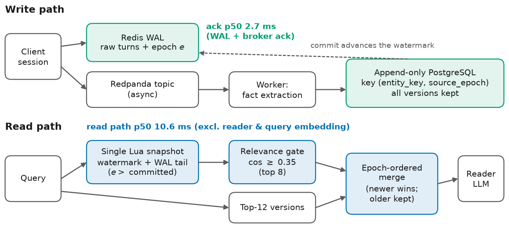

# DeltaWAL: read-after-write staleness and history erasure in asynchronous agent memory

Agent memories that extract facts from each conversation session (Mem0-style pipelines) usually run
extraction **asynchronously**, behind a message broker, so writes acknowledge in milliseconds instead of
waiting seconds for an LLM call. The cost: a question that arrives while the newest session is still being
extracted is answered from a **superseded fact**. Once the update does commit, stores that update in place,
and read paths that hide superseded facts, **erase the earlier value**, so "what did I have before?"
questions fail. This repo measures both failures on LongMemEval-S and ships **DeltaWAL**, a small fix: write raw
turns to a Redis write-ahead log with monotonic epochs *before* the broker publish, and at read time merge
the relevance-gated uncommitted tail with the stored facts in epoch order. **DeltaWAL-Versioned** also keeps
every fact version.

Paper: *Read-After-Write Staleness and History Erasure in Asynchronous LLM Agent Memory*, Jagrit Vats
(preprint). PDF: [`paper/main.pdf`](paper/main.pdf).



## Headline results

All numbers below are copied from [`paper/numbers_manifest.json`](paper/numbers_manifest.json), the single
source for every number in the paper. Each cell is one greedy run, so the intervals in the paper cover only
question sampling.

**Knowledge-update (KU) accuracy, %, with one session in flight** (LongMemEval-S held-out split: 60 KU questions;
keys `tab1/<reader>/<system>/<lag>/KU`):

| System | gemma4 (12B, local) | glm-5.3 | gpt-6-luna |
|---|---:|---:|---:|
| B1_sync, lag 0 (extraction on the write path; reference) | 83.3 | 76.7 | 80.0 |
| B2_async, lag 1 (plain async store) | 10.0 | 11.7 | 11.7 |
| B3, lag 1 (async store + recency window of raw user turns, matched token budget) | 63.3 | 80.0 | 71.7 |
| **DeltaWAL-Versioned, lag 1** | **88.3** | **96.7** | **93.3** |

* **The relevance gate does the work.** Filling the same tail budget with the *newest* uncommitted turns
  instead of the gated ones drops overall accuracy from 84.5% to 39.1%. That is pooled over the three readers
  and 138 questions: 193 questions won and 5 lost, p < 0.001 (`paired/abl_nogate/pooled`). The evidence usually
  sits earlier in the in-flight session, not at its end. A plain recency window (B3) recovers part of the loss
  but still gives stale answers on 11.7–30.0% of KU questions (`tab1/*/B3_recency_matched_user/lag1/stale_read_pct_KU`).
  An explicit "newer wins" instruction adds nothing measurable.
* **Writes stay cheap.** The median write acknowledgement is 2.67 ms for DeltaWAL, against 10,168 ms for B1, which
  extracts with a local model before acknowledging (`tab6/DeltaWAL (warm)/write_ack/p50_ms`, `tab6/B1 sync/write_ack/p50_ms`).
  Those 2.67 ms are with in-memory Redis. With `appendfsync always`, the median is 18.32 ms, against 7.27 ms
  non-durable in the same back-to-back rerun on a loaded machine (`latency_durable`).

**History erasure in Mem0 OSS 1.0.11** (a widely used open-source memory library; 60 KU questions, 13 of them ask
about an earlier value; keys `tab4/<reader>/<system>/lag0`):

| Mem0 OSS 1.0.11, lag 0 | gemma4 | glm-5.3 | gpt-6-luna |
|---|---:|---:|---:|
| Mem0 search, KU (all 60) | 76.7 | 76.7 | 76.7 |
| Mem0 search, KU-past (13) | 46.2 | 46.2 | 53.8 |
| + read-only `Memory.history()` hook, KU (all 60) | 91.7 | 91.7 | 88.3 |
| + read-only `Memory.history()` hook, KU-past (13) | 100.0 | 100.0 | 100.0 |

Mem0's in-place `UPDATE` removes earlier values from what search returns, while its history table still holds them.
A read-only hook that adds them back in epoch order wins 25 of 180 reader-question pairs and loses none, pooled
(p = 0.001, `paired/mem0_hook_vs_sync_ku`). No change to Mem0 itself is needed:
[`examples/mem0_history_hook.py`](examples/mem0_history_hook.py).

**Where epoch precedence breaks.** On MemConflict's static "false correction" items, newer-wins ordering makes
readers believe a false later statement more often. Also, the 12B local reader loses temporal accuracy once raw
turns enter the prompt. Both are reported in the paper, Sections 3–5.

## Quickstart (3 commands)

Rebuild every table, figure and the numbers manifest from the committed result snapshot. This needs no
datasets, model access, API keys or databases, only [uv](https://docs.astral.sh/uv/):

```bash
git clone https://github.com/jagritvats/deltawal && cd deltawal
uv sync --group paper
bash reproduce_assets.sh          # -> paper/tables/*.tex, paper/figures/*.pdf, paper/numbers_manifest.json (byte-identical)
```

To see the design in two minutes, run the self-contained examples. They need no API keys and fall back to an
in-process store if Redis is not running:

```bash
uv run python examples/deltawal_minimal.py
uv run python examples/mem0_history_hook.py --dry-run
```

To run the real stack (Redpanda, Redis, PostgreSQL/pgvector), use `docker compose up -d --wait`, then see
[Full reproduction](#full-reproduction) below.

## How DeltaWAL works

1. **Write path** (identical for every DeltaWAL variant). For each session, `INCR` a per-user epoch and write the raw
   turns to a Redis sorted set, scored by epoch, *before* publishing to the broker. The client is acknowledged
   at that point. An async worker extracts facts and commits them to PostgreSQL. The mutable variants use
   compare-and-set (CAS) fencing on `source_epoch`; DeltaWAL-Versioned appends one row per (entity, epoch). The
   worker then advances a contiguous committed-epoch watermark.
2. **Read path.** A single Lua call atomically returns the watermark plus every uncommitted turn and its
   embedding (`src/epochmem/store/wal.py`, `_SNAPSHOT_LUA`). Turns whose cosine similarity to the query is
   ≥ τ = 0.35 (at most 8, calibrated on a disjoint dev split) are merged with the top-12 stored facts. Everything
   is sorted by epoch and tagged `[OLDER MEMORY | epoch=… | date]` or `[NEWER MESSAGE | epoch=… | date]`.
3. **Versioning.** DeltaWAL-Versioned never overwrites a fact, so questions about earlier values still find them.
   Keeping versions *in the store* is what restores them; changing the prompt format alone does not.

## Systems

| System | Write path | Store policy | Read path |
|---|---|---|---|
| `B1_sync` | extract + index synchronously before the query is answered | in-place upsert (mutable) | vector top-k facts |
| `B1_sync_versioned` | as B1 | append-only, one row per (entity_key, source_epoch) | top-k versions, epoch-tagged |
| `B2_async` | async worker; the last `lag` sessions are in flight | last-writer-wins | vector top-k facts |
| `B3_recency_matched_user` | as B2 | last-writer-wins | top-k facts + recent raw user turns, token budget matched to DeltaWAL |
| `deltawal_prompt` | Redis write-through WAL (monotonic epoch) before the broker publish | CAS fence on `source_epoch` | facts + relevance-gated WAL tail, epoch-ordered merge |
| `deltawal_shadow_v2` | as deltawal_prompt | CAS fence | as deltawal_prompt, but stored facts contradicted by a newer WAL sentence are masked |
| `deltawal_lazy` | as deltawal_prompt | CAS fence | in-flight sessions are extracted at query time |
| `deltawal_versioned` | as deltawal_prompt | append-only versions | versions + gated WAL tail, epoch-ordered merge (older values kept) |
| `Mem0_sync` / `Mem0_async` / `Mem0_deltawal` | Mem0 OSS 1.0.11 (`scripts/run_mem0.py`) | Mem0 ADD/UPDATE/DELETE | Mem0 search; `Mem0_deltawal` adds the WAL tail |

The hyper-parameters are frozen and were calibrated on a disjoint 20-question dev split, never tuned on test: WAL
relevance gate `wal_sim_threshold = 0.35`, and Shadow v2 masking threshold `shadow_v2_threshold = 0.72`.

**Evaluation sets:**
* LongMemEval-S (cleaned): a held-out split of 138 questions and a disjoint 60-question non-update regression split.
* Mem0 OSS 1.0.11 on the 60 held-out KU questions.
* A 90-question MemConflict split, audited by four LLM raters from three model families.

**Judges:** qwen3.8-flash grades every answer. claude-haiku-5-5 re-grades every answer as a second judge from a
different model family, and a GPT-family model checks a 50-row sheet.

## Fault axes and metrics

* `lag` in {0, 1, 3, 5}: sessions still in flight when the query fires (deterministic barrier, no sleeps).
* `p_ooo` in {0.0, 0.3}: straggler model; commits are reordered with probability `p_ooo`.
* **Accuracy** is scored per LongMemEval question-type rubric.
* **Stale-read rate:** the answer is wrong and matches the superseded value.
* **OOCR:** keys left at an older epoch after commits were reordered.
* **Tokens:** mean reader prompt tokens.
* Wall-clock latency is measured only by `scripts/bench_latency.py`, on the real stack.

## Repository layout

```
examples/           two self-contained snippets: the DeltaWAL write/read path, the Mem0 history hook
configs/            one YAML per experiment (frozen thresholds, model ids, budgets)
src/epochmem/       data loaders, WAL/stores, systems, judge, guarded + cached model clients
scripts/            runners, judges, reports, and build_paper_assets.py
tests/              unit tests (CAS fencing, WAL snapshot, DeltaWAL merge, Mem0 wrapper, paper assets)
paper/data/         snapshot.json.gz: slim per-row verdicts + benchmark summaries (no dataset text)
paper/tables/       generated LaTeX tables (booktabs)
paper/figures/      generated vector figures (+ preview/*.png at 200 dpi)
paper/numbers_manifest.json   every number in the tables/figures, with CIs and source hashes
```

## Reproducing the paper assets

All tables, figures and the manifest come from `scripts/build_paper_assets.py`; no number is typed by
hand. The build is deterministic: two builds are byte-identical. It fails on any matplotlib warning, on
overlapping or clipped text, and on any box label that does not fit its box.

### 1. From the committed snapshot (no data, models or infrastructure)

```bash
uv sync --group paper
bash reproduce_assets.sh                 # paper/tables/*.tex, paper/figures/*.pdf, numbers_manifest.json
bash reproduce_assets.sh --check-tex     # + compile everything with TeX Live (docker) at 6.5 in text width
uv run pytest -q                         # unit tests + table <-> manifest consistency (some tests need the docker stack)
```

### 2. From cached run artifacts

With the run directories under `runs/`, and the SQLite model cache under `.cache/`, re-collect the snapshot and
rebuild:

```bash
bash reproduce_assets.sh --collect
```

Every report script also re-runs from the cache at no model cost. The run artifacts are not part of this
repository.

### Full reproduction

**Prerequisites:**
* Docker and [uv](https://docs.astral.sh/uv/).
* A local Ollama with `gemma4:12b-it-qat` and `qwen3-embedding:0.6b`.
* An OpenAI-compatible endpoint key in `.env` (`OPENCODE_API_KEY`), for the cloud extractor, readers and judge.

Any call to a non-localhost endpoint requires `--allow-cloud`. Every call is cached in SQLite, so re-running a
command costs nothing.

```bash
uv sync --group paper
docker compose up -d --wait                          # Redpanda, Redis, PostgreSQL/pgvector
uv run python scripts/download_data.py               # pinned revision, sha256-verified
uv run python scripts/verify_env.py
uv run pytest -q

# splits
uv run python scripts/make_heldout_slice.py          # 138 held-out questions (dev split excluded)
uv run python scripts/make_regression60_slice.py     # 60 non-update questions, disjoint
uv run python scripts/make_memconflict_split.py --write-split

# held-out LongMemEval-S; extraction first (cloud extractor), then readers, then one judge pass
uv run python scripts/precompute_extractions.py --config configs/m2_heldout.yaml --workers 8 --allow-cloud
uv run python scripts/run_m1.py --config configs/m2_heldout.yaml --run-id m2ho_gemma --no-judge --core --cells "1:0,3:0,5:0,1:0.3,3:0.3" --allow-cloud
uv run python scripts/run_m1.py --config configs/m2_heldout.yaml --run-id m2ho_glm --reader opencode-zen/glm-5.3 --no-judge --core --cells "1:0,3:0,1:0.3" --allow-cloud
uv run python scripts/run_m1.py --config configs/m2_heldout.yaml --run-id m2ho_luna6 --reader opencode-zen/gpt-6-luna --no-judge --core --cells "1:0,3:0,1:0.3" --allow-cloud
for r in gemma:gemma4:12b-it-qat glm:opencode-zen/glm-5.3 luna6:opencode-zen/gpt-6-luna; do
  id=${r%%:*}; model=${r#*:}
  uv run python scripts/run_m1.py --config configs/m2_heldout.yaml --run-id m2ctl_$id --reader $model --no-judge \
      --systems B1_sync_versioned deltawal_prompt --core --cells "0:0" --allow-cloud
  uv run python scripts/run_m1.py --config configs/m2_heldout.yaml --run-id m2uni_$id --reader $model --no-judge \
      --systems deltawal_versioned --core --cells "0:0,1:0,3:0" --allow-cloud
done
uv run python scripts/run_m1.py --config configs/m2_heldout.yaml --run-id m2uni_gemma --no-judge \
    --systems deltawal_versioned --core --cells "5:0" --allow-cloud
uv run python scripts/judge_all.py --config configs/m2_heldout.yaml --runs m2ho_gemma m2ho_glm m2ho_luna6 \
    m2ctl_gemma m2ctl_glm m2ctl_luna6 m2uni_gemma m2uni_glm m2uni_luna6 --judge opencode-zen/qwen3.8-flash --allow-cloud
uv run python scripts/forensics_heldout.py --allow-cloud
uv run python scripts/sensitivity_shadow.py --run-id m2ho_gemma --judge opencode-zen/qwen3.8-flash --allow-cloud
uv run python scripts/judge_agreement.py --allow-cloud
uv run python scripts/bench_latency.py --config configs/m2_dev_local.yaml --questions 10 --no-reader
cp runs/bench_latency_m2.json runs/bench_latency_m2v2_no_reader.json

# non-update regression
uv run python scripts/precompute_extractions.py --config configs/m3_regression60.yaml --workers 16 --allow-cloud
for r in gemma:gemma4:12b-it-qat luna6:opencode-zen/gpt-6-luna; do
  id=${r%%:*}; model=${r#*:}
  uv run python scripts/run_m1.py --config configs/m3_regression60.yaml --run-id m3r60_$id --reader $model --no-judge --core \
      --cells "0:0,1:0" --systems B1_sync deltawal_versioned --allow-cloud
  uv run python scripts/run_m1.py --config configs/m3_regression60.yaml --run-id m3r60_$id --reader $model --no-judge --core \
      --cells "1:0" --systems B2_async B3_recency_matched_user --allow-cloud
done
uv run python scripts/run_m1.py --config configs/m3_regression60.yaml --run-id m3r60_glm --reader opencode-zen/glm-5.3 --no-judge \
    --core --cells "0:0,1:0" --systems B1_sync deltawal_versioned --allow-cloud
uv run python scripts/judge_all.py --config configs/m3_regression60.yaml --runs m3r60_gemma m3r60_luna6 m3r60_glm \
    --judge opencode-zen/qwen3.8-flash --audit-n 0 --summary-name judge_regression60_summary.json --allow-cloud

# Mem0 OSS 1.0.11: ingest once, then read with each reader, then the read-only history hook (--all-ku: all 60 KU questions)
uv run python scripts/run_mem0.py --run-id m3mem0_luna6 --reader opencode-zen/gpt-6-luna --ingest-only --ingest-workers 6 --allow-cloud
uv run python scripts/run_mem0.py --run-id m3mem0_luna6 --reader opencode-zen/gpt-6-luna --allow-cloud
uv run python scripts/run_mem0.py --run-id m3mem0_gemma --reader gemma4:12b-it-qat --allow-cloud
uv run python scripts/run_mem0.py --run-id m3mem0_glm --reader opencode-zen/glm-5.3 --systems Mem0_sync Mem0_deltawal --allow-cloud
for r in gemma:gemma4:12b-it-qat luna6:opencode-zen/gpt-6-luna glm:opencode-zen/glm-5.3; do
  uv run python scripts/run_mem0_history_hook.py --run-id m6hook60_${r%%:*} --reader ${r#*:} --all-ku --allow-cloud
done

# MemConflict
uv run python scripts/precompute_extractions_cloudonly.py --config configs/m3_memconflict.yaml --workers 16 --allow-cloud
for r in gemma:gemma4:12b-it-qat luna6:opencode-zen/gpt-6-luna glmflash:opencode-zen/glm-5.3-flash; do
  id=${r%%:*}; model=${r#*:}
  uv run python scripts/run_m1.py --config configs/m3_memconflict.yaml --run-id m3mc_$id --reader $model --core --no-judge \
      --cells "0:0,1:0" --systems B1_sync deltawal_versioned --allow-cloud
  uv run python scripts/run_m1.py --config configs/m3_memconflict.yaml --run-id m3mc_$id --reader $model --core --no-judge \
      --cells "1:0" --systems B2_async B3_recency_matched_user --allow-cloud
done
uv run python scripts/judge_all.py --config configs/m3_memconflict.yaml --runs m3mc_gemma m3mc_luna6 m3mc_glmflash \
    --judge opencode-zen/qwen3.8-flash --audit-n 0 --summary-name judge_memconflict_summary.json --allow-cloud

# text reports and paper assets
uv run python scripts/report_unified.py
uv run python scripts/report_controls.py
uv run python scripts/report_m3.py --stage regression   # also: --stage mem0, --stage memconflict
bash reproduce_assets.sh --collect --check-tex
```

The ablations, reordering runs, temporal probes and second-judge re-grade use the configs and run-id groups
listed in `RUN_GROUPS` at the top of `scripts/build_paper_assets.py`.

Never run two local Ollama jobs at the same time, or two writers to the same PostgreSQL tables. Cloud cost is
dominated by fact extraction (one extractor call per session); `scripts/zen_spend.py` reports spend.

## Engineering guarantees

* Every LLM and embedding call goes through a SQLite cache keyed by sha256(model + messages + params).
* Any non-localhost model endpoint raises an error unless `--allow-cloud` is passed. Each process has a spend cap.
* Each run appends one row per answer to `runs/<run_id>/results.jsonl`; re-running a run id resumes it.
* `seed = 42` everywhere: sampling, commit schedules, decoding and the bootstrap.
* Bootstrap CIs use 2,000 resamples of questions. Cells pooled over several runs or readers resample questions as clusters.
* Paired comparisons use exact McNemar per reader, and a question-level sign-flip permutation test when pooled.

## Citation

```bibtex
@misc{vats2026deltawal,
  title         = {Read-After-Write Staleness and History Erasure in Asynchronous {LLM} Agent Memory},
  author        = {Vats, Jagrit},
  year          = {2026},
  howpublished  = {\url{https://github.com/jagritvats/deltawal}},
  note          = {Preprint}
}
```

## License

Code: MIT ([`LICENSE`](LICENSE)). Third-party components and datasets keep their own licenses; see [`NOTICE`](NOTICE).
No benchmark dialogue is redistributed. `scripts/download_data.py` fetches LongMemEval-S at a pinned revision,
and MemConflict must be obtained from its authors' repository.
