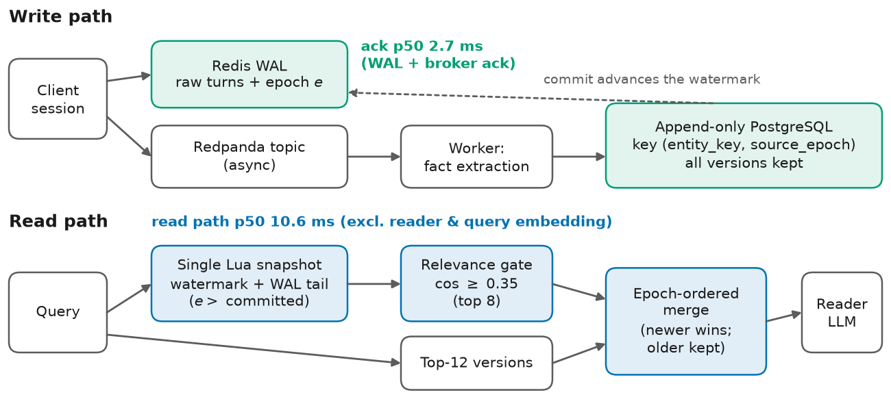
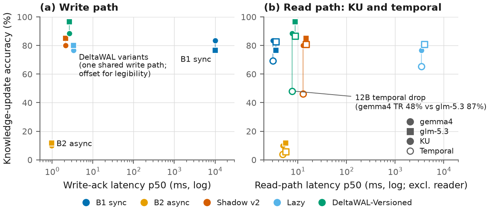
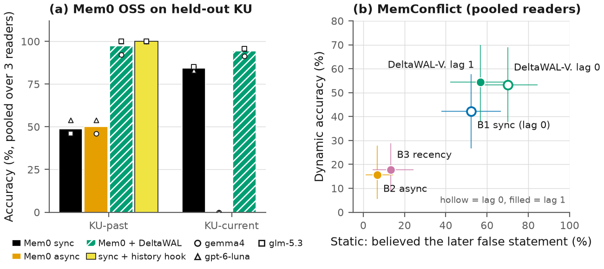
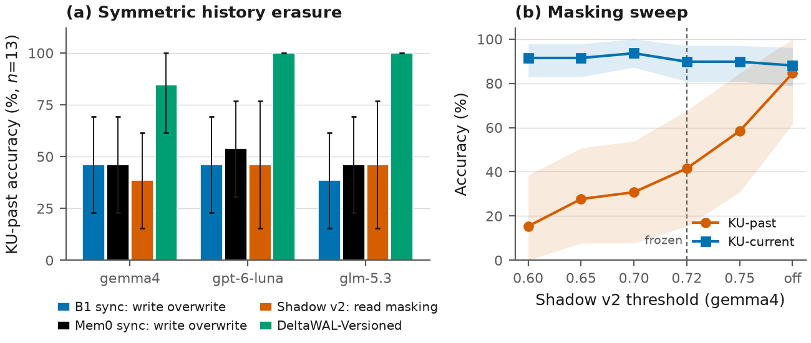

# Read-After-Write Staleness and History Erasure in Asynchronous LLM Agent Memory

*Anonymous authors. Markdown twin of `paper/main.pdf`, generated by `scripts/paper_to_md.py` from the same sources; every number comes from `paper/numbers_manifest.json`.*

# Abstract

LLM agent memories that extract facts from each conversation session often run extraction asynchronously, behind a message broker. A question can then arrive before the newest session is committed, and the reader answers from a superseded fact. Once the update is committed, stores that update in place, and read paths that mask superseded facts, lose the earlier value. We formalise both failures, read-after-write staleness and history erasure, and measure them on LongMemEval-S with a deterministic lag barrier and a commit-reordering model. We propose DeltaWAL, which writes raw turns with monotonic epochs to a write-ahead log before the broker publish and merges the uncommitted, relevance-gated log tail with stored facts in epoch order; DeltaWAL-Versioned also keeps every fact version. When the update is the session still in flight, an asynchronous store answers at most 11.7% of knowledge-update questions correctly across three readers, while DeltaWAL-Versioned answers 96.7% with glm-5.3, its own score with a complete store, and acknowledges writes in milliseconds. Ablations show that the relevance gate carries this gain, while an explicit newer-wins instruction adds nothing measurable. In-place updates and read-side masking both erase answers to questions about earlier values; keeping versions in the store, not the prompt format, restores them, and Mem0 OSS 1.0.11 shows the same loss, which a read-only history hook recovers. On MemConflict, audited by four LLM raters from three model families, the system ordering replicates for genuine updates; on a small set of false corrections, newer-wins ordering makes readers believe the false statement more often, an exploratory limit of the design.

# 1 Introduction

Long-term memory for LLM agents is usually built by extracting facts from each conversation session with an LLM, embedding them, and retrieving the most similar facts when a question arrives (Park et al. 2023; Zhong et al. 2024; Packer et al. 2023; Chhikara et al. 2025; Xu et al. 2025; Rasmussen et al. 2025). Extraction costs one model call per session and takes seconds. A deployment that runs it on the write path makes the client wait; a deployment that moves it behind a message broker acknowledges the write immediately, but then the newest sessions are not yet in memory when the next question arrives. Benchmarks for conversational memory (Maharana et al. 2024; Wu et al. 2025) evaluate systems whose store is complete when the question is asked, so they do not see this window.

This paper studies two ways in which a fact-extraction memory returns the wrong value for a key that has changed. The first is *read-after-write staleness*: the session containing an update has been acknowledged but not committed, and the reader answers from the superseded fact. In distributed-systems terms this violates read-your-writes (Terry et al. 1994). The second is *history erasure*: once the update is applied, the store or the read path keeps only the newest value, and questions about the earlier value (“what was my previous goal?”) become unanswerable. Erasure happens on the write side when a store updates a key in place, and on the read side when a retrieval step masks facts it believes superseded.

We make both failures measurable on LongMemEval-S (Wu et al. 2025). A deterministic barrier holds the newest $\ell$ sessions in flight when a question fires, and a straggler model reorders commits with probability $p_\text{ooo}$. We then propose DeltaWAL, which treats the raw conversation as a write-ahead log (Mohan et al. 1992). Every session is written through to a Redis log with a monotonic epoch before the broker publish. At read time, one atomic call returns the committed watermark and the uncommitted log tail. Relevant uncommitted turns are merged with the stored facts in epoch order, and the reader is told that the higher epoch wins. DeltaWAL-Versioned adds an append-only store keyed by (entity key, source epoch), so no value is overwritten.

The main findings are as follows. When the update is the session in flight, an asynchronous store without the log answers between 10.0% and 11.7% of knowledge-update questions correctly across three readers (Table 1). DeltaWAL-Versioned scores 96.7% with glm-5.3 at lags 1 and 3, the same as at lag 0, and acknowledges writes in 2.67 ms at the median, where synchronous extraction waits for an LLM call per session (10,168 ms with our local 12B extractor; our cloud extractor took 4.26 s per call; Table 3). Ablations attribute the gain to the relevance gate: filling the same token budget with the most recent uncommitted turns instead drops accuracy from 84.5% to 39.1% (pooled over readers), while removing the newer-wins instruction changes nothing measurable (Table 8). With the 12B local reader, temporal accuracy drops at lag 1 (48.1% against 65.4% at lag 0); prompt length is not the cause. At lag 0, an in-place store answers 43.6%–46.2% of questions about a previous value whether or not the prompt carries epoch tags, and an append-only store 97.4% (Table 2). Read-side masking also costs these questions, and costs more the more it masks. Mem0 OSS, whose classic write path updates memories in place, shows the same loss, and a read-only hook that shows its stored history to the reader recovers it (Table 6). On the dynamic conflicts of MemConflict (Tao et al. 2026), an independently generated dataset, the ordering of systems replicates. On its static conflicts, where the later statement is false by construction, newer-wins ordering leads the reader to believe the false statement more often; we report this as an exploratory boundary, because four raters find at most 20 of the 30 static questions clean (Section 5.3).

Our contributions are:

- A formulation of read-after-write staleness and history erasure for asynchronous fact-extraction memory, with a deterministic lag barrier and reordering model that make both reproducible without timing (Section 2).

- DeltaWAL and DeltaWAL-Versioned: a write-through raw log with monotonic epochs, a relevance gate and an epoch-ordered merge that needs no extra model call, over an append-only store (Section 2.3), with ablations that isolate the gate as the component that matters.

- An evaluation on LongMemEval-S with three readers, every cell measured natively, paired tests, and two judges from different model families, together with latency on a real broker, log and vector store (Sections 3 and 6).

- History ablations showing that in-place overwrite and read-side masking both erase answers about earlier values, and that a compare-and-set fence prevents reordering corruption but not missed merges (Section 4).

- External checks on non-update questions, on Mem0 OSS with in-place updates, and on MemConflict with a blind audit of every evaluated question by four LLM raters from three model families, including an exploratory negative result for epoch precedence on false corrections (Section 5).

Code and run artifacts are provided as supplementary material.

# 2 System and Problem Formulation

**Figure 1.** DeltaWAL-Versioned. *Write path*: raw turns and a monotonic epoch e are written through to a Redis WAL before the broker publish; the write is acknowledged after the WAL write and the broker acknowledgement (median 2.67 ms, Table 3). A worker extracts facts into an append-only PostgreSQL/pgvector store keyed by (entity key, source epoch) and advances the committed watermark. *Read path*: one Lua call snapshots the watermark and the uncommitted WAL tail; a cosine gate (τ=0.35, at most m=8 turns) selects relevant turns, which are merged with the top-k stored versions (k=12) in epoch order under a newer-wins instruction, keeping older versions visible. Median read path 10.6 ms, excluding the reader and the query embedding.

## 2.1 Setting

#### Sessions, facts and the watermark.

A user talks to an agent in sessions. When a session is written to memory it receives an epoch $e$ from a per-user counter that increases strictly in write order. A question $q$ arrives after the session with epoch $T$ has been written and acknowledged. An extractor $\phi$ maps each session to facts $f=(x, v, e)$: a normalised entity key $x$, a fact text $v$ and the source epoch $e$. In an asynchronous pipeline the write is acknowledged once the session is on a broker; a worker later runs $\phi$, embeds the facts and commits them to a vector store $M$. With $C$ the set of committed epochs, the committed watermark $$W = \max\{\, w : e \in C \text{ for every epoch } e \le w \,\}$$ is the largest epoch below which nothing is missing. At query time a system retrieves the top-$k$ stored items by cosine similarity to $q$, renders them into a prompt, and a reader LLM answers.

#### Lag and reordering.

A deterministic barrier replaces wall-clock timing. At lag $\ell$, the in-flight set is $I_\ell = \{e : T-\ell < e \le T\}$ and every older session is committed; $\ell=0$ means the store is complete. To model stragglers, each older session is independently delayed, with probability $p_\text{ooo}$, to a uniformly random later commit slot. The in-flight tail does not depend on $p_\text{ooo}$, so the two fault axes are independent, and both are functions of the seed, the question and $(\ell, p_\text{ooo})$.

#### Store policies.

When the worker commits $(x, v, e)$ and the store holds $(x, v', e')$, *last-writer-wins* (LWW) replaces the old row unconditionally, *compare-and-set* (CAS) replaces it only if $e > e'$ (a conditional upsert in PostgreSQL), and *append* keeps both rows under the key $(x, e)$. LWW and CAS are in-place policies: after an update one value per key survives. They coincide when commits arrive in order. Under reordering, LWW can leave an older value in place. A key is *updated* if at least two committed epochs wrote it and *corrupted* if its stored epoch is below the newest committed epoch for that key; the out-of-order corruption rate (OOCR) is the corrupted fraction of updated keys.

## 2.2 Two failure modes

#### Read-after-write staleness.

If the answer to $q$ depends on a fact from a session in $I_\ell$, typically an update, a system that reads only $M$ answers with the earlier value. This violates read-your-writes (Terry et al. 1994): the write was acknowledged, yet the next read does not reflect it. A *stale read* is a wrong answer to a knowledge-update question that matches the superseded value.

#### History erasure.

Some questions ask about an earlier value, such as “what was my previous goal”. Let key $x$ hold $v_\text{old}$ at epoch $e_\text{old}$ and $v_\text{new}$ at a later epoch. History is erased if $v_\text{old}$ cannot reach the reader. On the *write side*, an in-place policy (LWW, CAS, or Mem0’s UPDATE) overwrites $v_\text{old}$ when $v_\text{new}$ commits, and no read path can recover it. On the *read side*, a read path that masks stored items it believes superseded removes $v_\text{old}$ from the prompt although the store kept it. Both apply the rule “keep only the newest value”, at different points. A related failure is the *missed merge*: the extractor files $v_\text{new}$ under a key $x' \neq x$, so no keyed policy can supersede $v_\text{old}$ and both values look current.

## 2.3 Systems

All systems share the extractor, the embedder, $k$ and a reader system prompt that asks for a short answer and for “I don’t know” when memory lacks the information.

#### Baselines.

**B1 sync (mutable)** extracts, embeds and upserts each session before acknowledging it, with LWW, and lists the top-$k$ facts with their session dates. **B1 sync (versioned)** uses the append policy and renders the retrieved versions in epoch order with epoch tags and the precedence instruction described below; it isolates the effect of keeping versions. **B2 async** acknowledges after the broker publish, commits with LWW, and reads only committed facts. **B3 recency (matched)** adds to B2 the trailing raw user turns that fit in a whole-prompt budget of 1050 tokens, without epoch tags, gating or precedence instruction.

#### DeltaWAL write path.

For each session, the client increments the epoch counter in Redis and appends the raw turns with that epoch to a Redis write-ahead log (WAL) in one pipelined transaction, then publishes the session to the broker. The write is acknowledged after both steps. A background embedder computes turn and sentence embeddings off the acknowledgement path. The worker extracts facts, commits them with CAS on the source epoch, and advances $W$; WAL entries at or below $W$ are trimmed. As in database write-ahead logging (Mohan et al. 1992), an acknowledged write is readable before the derived state, here the extracted facts, exists; it is also durable only if Redis persists the log (Section 6 measures that cost). The per-user epoch is a single-writer instance of a logical clock (Lamport 1978).

#### DeltaWAL read path.

One Lua script, executed atomically in Redis, returns $W$ and every uncommitted WAL turn with its stored embeddings; turns not yet embedded are embedded at read time (a *cold* read). A gate keeps the turns with cosine similarity to $q$ of at least $\tau=0.35$, at most $m=8$ of them. The prompt merges the top-$k$ stored facts (tagged as older memory) and the gated turns (tagged as newer messages) in epoch order, each with its epoch and date. The system prompt adds a precedence instruction: if two items disagree about the same thing, the one with the higher epoch is current. No model call is added. We evaluate four variants: **DeltaWAL (prompt)** is this merge over the CAS store. **Shadow** additionally masks a stored fact when some sentence of a newer gated turn has cosine similarity at least $\theta=0.72$ with it (the tables label this sentence-level variant with its version suffix). **Lazy** runs the extractor on the gated turns at query time, one extra LLM call, and drops stored facts whose key reappears with a newer epoch. **DeltaWAL-Versioned** (Figure 1) is the prompt variant over the append store, so older values are never overwritten at any lag. At $\ell=0$ its WAL tail is empty and it reads the same state as a synchronous versioned store. The thresholds $\tau$ and $\theta$ were calibrated on a disjoint dev split and frozen before any held-out run.

# 3 Experimental Setup and Main Results

## Setup

#### Benchmark.

We use the cleaned release of LongMemEval-S (Wu et al. 2025). The held-out set has 138 questions: every knowledge-update (KU, 60) and abstention (26) question outside the dev split, and 52 temporal-reasoning questions. We split KU into *KU-past* (13 questions whose wording asks about an earlier value, matched by a fixed list of cue words such as “previously” and “before”) and *KU-current* (47). A disjoint dev split of the same question types was used only to calibrate $\tau$ and $\theta$ and to measure latency. For each question the stream ends right after the last evidence session; for KU questions this is the update, so at $\ell \geq 1$ the update is in flight. Abstention questions keep their full history. Unless stated otherwise, $p_\text{ooo}=0$.

#### Models.

The extractor is glm-5.3-flash, run once per session. It sees user turns in full, assistant turns truncated to 300 characters, and the list of keys already in use so that updates can reuse a key. Embeddings come from qwen3-embedding:0.6b, and $k=12$. The readers are gemma4 (12B, quantised, local), glm-5.3 and gpt-6-luna (API). All calls use temperature zero and seed 42 and are cached, so each cell is a single deterministic run. Accuracy runs pass every session through the real broker (Redpanda, which speaks the Kafka protocol (Kreps et al. 2011)), Redis and PostgreSQL with pgvector, with an in-process worker committing cached extractions; only timing is replaced by the barrier.

#### Judge and statistics.

One judge, qwen3.8-flash, grades every answer in the paper with the per-type LongMemEval rubric, in the LLM-as-a-judge setup of Zheng et al. (2023). A second call labels abstention and, for KU questions, use of the superseded value, which gives the stale-read rate. Against qwen4-max on 654 verdict pairs, Cohen’s $\kappa$ is 0.967 for correctness and 0.978 for stale reads. A second judge from another model family, claude-haiku-5-5, re-graded every answer with the same prompts and agrees on 97.8% of correctness verdicts ($\kappa=0.949$; 0.985 for stale reads; Table 10); every comparison we report keeps its direction under it. One author labelled a 50-row check sheet, stratified by question type and judge verdict (38 distinct questions), blind to system identity and judge labels, followed by a rule-based consistency check that does not use judge labels. Agreement with the judge is 96.0% \[90.0, 100.0\] for correctness ($\kappa=0.920$ \[0.79, 1.00\]), 96.0% \[90.0, 100.0\] for abstention ($\kappa=0.911$ \[0.77, 1.00\]) and 94.1% \[82.3, 100.0\] for stale reads ($\kappa=0.821$ \[0.00, 1.00\]; $n=17$ KU rows, 4 human-labelled positives). Intervals are 95% percentile bootstrap intervals over questions (2000 resamples); pooled cells resample questions as clusters. Paired comparisons give the questions won and lost, an exact McNemar test per reader, and, pooled over readers, a sign-flip permutation test with the question as the unit.

## 3.2 Main results

**Table 1.** LongMemEval-S held-out set (138 questions: 60 knowledge-update, 52 temporal, 26 abstention). Accuracy (%) with 95% bootstrap CIs over questions; stale-read = share of KU questions answered with the superseded value; tokens = mean reader prompt tokens. Async systems use the deterministic lag barrier with no reordering (p_ooo = 0). Every cell is measured natively; the judge is qwen3.8-flash throughout.

| System | Lag | Overall | KU | Temporal | Abstention | Stale (%) | Tokens |
|---|---|---|---|---|---|---|---|
| *Reader: gemma4 (12B, local)* |  |  |  |  |  |  |  |
| B1 sync (mutable) | 0 | 79.7 [72, 86] | 83.3 [73, 92] | 69.2 [56, 81] | 92.3 [81, 100] | 3.3 | 664 |
| B2 async | 1 | 23.2 [17, 30] | 10.0 [3, 18] | 3.8 [0, 10] | 92.3 [81, 100] | 68.3 | 656 |
| B3 recency (matched) | 1 | 58.0 [49, 66] | 63.3 [52, 75] | 32.7 [21, 46] | 96.2 [88, 100] | 30.0 | 1012 |
| Shadow v2 | 1 | 69.6 [62, 77] | 80.0 [68, 90] | 46.2 [33, 60] | 92.3 [81, 100] | 5.0 | 1204 |
| Lazy | 1 | 75.4 [68, 83] | 76.7 [65, 87] | 65.4 [52, 77] | 92.3 [81, 100] | 1.7 | 893 |
| DeltaWAL-Versioned | 0 | 83.3 [78, 89] | 95.0 [88, 100] | 65.4 [52, 77] | 92.3 [81, 100] | 1.7 | 791 |
| DeltaWAL-Versioned | 1 | 73.9 [67, 81] | 88.3 [80, 95] | 48.1 [35, 62] | 92.3 [81, 100] | 8.3 | 1255 |
| DeltaWAL-Versioned | 3 | 74.6 [67, 82] | 88.3 [80, 95] | 50.0 [37, 63] | 92.3 [81, 100] | 8.3 | 1266 |
| DeltaWAL-Versioned | 5 | 76.1 [69, 83] | 91.7 [85, 98] | 50.0 [37, 63] | 92.3 [81, 100] | 6.7 | 1288 |
| *Reader: glm-5.3 (frontier, cloud)* |  |  |  |  |  |  |  |
| B1 sync (mutable) | 0 | 81.9 [75, 88] | 76.7 [65, 87] | 82.7 [71, 92] | 92.3 [81, 100] | 0.0 | 664 |
| B2 async | 1 | 24.6 [17, 33] | 11.7 [5, 20] | 5.8 [0, 13] | 92.3 [81, 100] | 53.3 | 656 |
| B3 recency (matched) | 1 | 66.7 [59, 74] | 80.0 [70, 90] | 38.5 [25, 52] | 92.3 [81, 100] | 11.7 | 1012 |
| Shadow v2 | 1 | 84.8 [79, 91] | 85.0 [75, 93] | 80.8 [69, 90] | 92.3 [81, 100] | 0.0 | 1204 |
| Lazy | 1 | 82.6 [76, 88] | 80.0 [68, 90] | 80.8 [69, 92] | 92.3 [81, 100] | 0.0 | 893 |
| DeltaWAL-Versioned | 0 | 91.3 [86, 96] | 96.7 [92, 100] | 86.5 [77, 94] | 88.5 [77, 100] | 0.0 | 791 |
| DeltaWAL-Versioned | 1 | 91.3 [86, 96] | 96.7 [92, 100] | 86.5 [77, 94] | 88.5 [77, 100] | 0.0 | 1255 |
| DeltaWAL-Versioned | 3 | 91.3 [86, 96] | 96.7 [92, 100] | 86.5 [77, 94] | 88.5 [77, 100] | 0.0 | 1266 |
| *Reader: gpt-6-luna (cloud)* |  |  |  |  |  |  |  |
| B1 sync (mutable) | 0 | 81.2 [74, 88] | 80.0 [70, 90] | 78.8 [67, 88] | 88.5 [77, 100] | 3.3 | 664 |
| B2 async | 1 | 23.2 [16, 30] | 11.7 [5, 20] | 3.8 [0, 10] | 88.5 [77, 100] | 61.7 | 656 |
| B3 recency (matched) | 1 | 63.8 [56, 72] | 71.7 [60, 82] | 40.4 [27, 54] | 92.3 [81, 100] | 20.0 | 1012 |
| Shadow v2 | 1 | 81.9 [75, 88] | 81.7 [72, 90] | 76.9 [65, 88] | 92.3 [81, 100] | 1.7 | 1204 |
| Lazy | 1 | 79.0 [72, 86] | 78.3 [67, 88] | 73.1 [62, 85] | 92.3 [81, 100] | 0.0 | 893 |
| DeltaWAL-Versioned | 0 | 89.1 [84, 94] | 93.3 [87, 98] | 82.7 [73, 92] | 92.3 [81, 100] | 3.3 | 791 |
| DeltaWAL-Versioned | 1 | 88.4 [83, 93] | 93.3 [87, 98] | 80.8 [69, 90] | 92.3 [81, 100] | 3.3 | 1255 |
| DeltaWAL-Versioned | 3 | 88.4 [83, 93] | 93.3 [87, 98] | 80.8 [69, 90] | 92.3 [81, 100] | 3.3 | 1266 |

#### Asynchrony without the WAL breaks updates.

With one session in flight, B2 answers 10.0–11.7% of KU questions correctly across readers, against 76.7–83.3% for B1 (Table 1); most errors are stale reads (53.3–68.3% of KU answers), and temporal accuracy falls to at most 5.8% because the last evidence session is the one in flight. A stronger reader does not help. B3’s recency window recovers part of the loss (63.3–80.0% on KU) but still reads stale values on 11.7–30.0% of KU questions. Table 8 decomposes the gap, pooled over readers. Dating B3’s raw turns, with nothing else changed, raises its temporal accuracy from 37.2% to 49.4% ($p=0.053$) but not its KU accuracy (67.2% vs. 71.7%). Moving the recency window onto DeltaWAL-Versioned’s store and prompt (epoch tags, precedence instruction, and a mean prompt that also grows from 1012 to 1256 tokens) raises KU accuracy to 85.0%, and replacing the window with the relevance gate raises overall accuracy by a further 42/10 questions won/lost ($p=0.002$). The gate is the essential component: filling the same budget with the newest uncommitted turns drops accuracy from 84.5% to 39.1%, because the evidence usually sits earlier in the in-flight session, and the gate admitted a turn of the update session for every KU question at lags 1, 3 and 5. Removing the precedence instruction changes nothing measurable (7 won, 10 lost, $p=0.580$); removing the explicit epoch labels from items that keep their session dates and chronological order adds little for glm-5.3 but costs KU questions for the 12B reader (0 won, 6 lost, $p=0.031$).

#### DeltaWAL-Versioned removes most of the cost of asynchrony.

The cleanest comparison is DeltaWAL-Versioned at lag $\ell$ against itself at $\ell=0$, where it reads the complete versioned store. For glm-5.3 the scores are identical at lags 0, 1 and 3 (91.3% overall, 86.2–95.7); for gpt-6-luna, lags 1 and 3 give 88.4% against 89.1% at lag 0, with stale reads at 0.0% and 3.3%. Against B1, DeltaWAL-Versioned at lag 1 is higher on KU for all three readers (7/4, 12/0 and 12/4 questions won/lost, exact $p=0.549$, \<0.001, 0.077; pooled permutation $p=0.018$), a gain Section 4 traces to KU-past questions, and it acknowledges writes in milliseconds instead of seconds (Figure 2a). The WAL tail costs tokens: 1255 prompt tokens at lag 1 against 791 at lag 0. Shadow and Lazy also beat B2 and B3 overall for every reader but stay below DeltaWAL-Versioned on KU (glm-5.3: 85.0% and 80.0% against 96.7%); both drop stored facts that a newer item supersedes, the read-side erasure of Section 4.

#### The 12B reader loses temporal accuracy when the WAL tail is in the prompt.

gemma4’s temporal accuracy with DeltaWAL-Versioned drops from 65.4% at lag 0 to 48.1% (34.6–61.5) at lag 1 (1 won, 10 lost, $p=0.012$) and stays there at lags 3 and 5, so its overall accuracy at lag 1 (73.9%) is below B1’s (79.7%), with overlapping intervals; glm-5.3 keeps 86.5% on the same prompts (Figure 2b). Prompt length is not the cause: a lag-0 prompt padded with further stored facts to the lag-1 length keeps 67.3% (Table 9). The failures come from how raw turns are presented: gemma4 abstains when a raw turn says “today”, or takes the message date for the event date, and dating the tail turns explicitly or placing them before the facts each recovers about half of the gap (57.7% and 57.7%, neither significant alone), while removing the precedence instruction does not help. Lazy, which turns the gated turns into facts first, keeps gemma4 at 65.4% at the cost of an extraction call per query.

**Figure 2.** Accuracy against median latency for gemma4 (circles) and glm-5.3 (squares); async systems at lag 1, B1 at lag 0. (a) KU accuracy against write-acknowledgement latency: B1 waits for extraction (10,168 ms); all DeltaWAL variants share one write path (2.67 ms; points offset for legibility). (b) KU (filled) and temporal (hollow) accuracy against read-path latency, excluding the reader; systems with near-identical latency (B1 and B2; DeltaWAL-Versioned and Shadow) and the two readers are offset slightly in x, keeping each pair's latency order. DeltaWAL-Versioned is plotted at the DeltaWAL read-path latency (10.6 ms), since it uses the same gate and merge. The annotation marks gemma4's temporal accuracy at lag 1 (48.1%) against glm-5.3's (86.5%). Latencies from Table 3.

# 4 History Ablations

Table 1 mixes two effects: whether a system sees the newest write, and whether it still sees the value that write replaced. Table 2 isolates the second: on the write side at lag 0, on the read side at $\ell \geq 1$, and for store integrity under reordering.

**Table 2.** History ablations on the 138 held-out questions. (a) Store policy and prompt format at lag 0: B1 sync (in-place, plain dated facts), the DeltaWAL prompt over its CAS store (in-place, epoch tags and precedence instruction), B1 sync over an append-only store with the same kind of epoch-tagged prompt, and DeltaWAL-Versioned (empty WAL); rows 2 and 3 differ only in the store, rows 1 and 2 only in the prompt. Pooled CIs resample questions. (b) Shadow v2 masking threshold, pooled over the five async cells (lag 1/3/5, p_ooo∈ {0, 0.3}); re-run = question-cells whose set of masked facts differs from the frozen threshold's and therefore needed a new reader call (the others keep the frozen-threshold answer); `off' is the unmasked epoch-merge prompt on the same cells; CIs resample questions. (c) Out-of-order corruption (an updated key left at an older epoch) vs. missed merges, counted on the knowledge-update questions: the update's facts share no key with the earlier evidence, so no keyed policy can supersede the old value.

*(a) Write side at lag 0: store policy and prompt format*

| Store | Prompt | KU-past, pooled (n=13 per reader) | KU-past per reader (gemma4 / glm / gpt) | KU-current, pooled (n=47 per reader) |
|---|---|---|---|---|
| in-place | plain (B1) | 43.6 [21, 69] | 46.2 / 38.5 / 46.2 | 90.1 [83, 96] |
| in-place | epoch tags (DeltaWAL prompt) | 46.2 [23, 69] | 46.2 / 46.2 / 46.2 | 92.9 [87, 99] |
| append-only | epoch tags (B1 versioned) | 97.4 [92, 100] | 92.3 / 100.0 / 100.0 | 94.3 [88, 99] |
| append-only | epoch tags (DeltaWAL-V.) | 97.4 [92, 100] | 92.3 / 100.0 / 100.0 | 94.3 [89, 99] |

*(b) Read side: Shadow v2 masking threshold (gemma4; frozen 0.72)*

| Threshold | Re-run | Overall | KU | KU-past | KU-current |
|---|---|---|---|---|---|
| 0.60 | 521 | 65.5 [58, 73] | 75.0 [63, 85] | 15.4 [0, 38] | 91.5 [83, 98] |
| 0.65 | 406 | 68.1 [61, 76] | 77.7 [67, 88] | 27.7 [8, 51] | 91.5 [83, 98] |
| 0.70 | 170 | 70.3 [63, 78] | 80.0 [70, 90] | 30.8 [8, 54] | 93.6 [87, 100] |
| 0.72 | 0 | 70.4 [63, 78] | 79.3 [69, 88] | 41.5 [15, 68] | 89.8 [81, 97] |
| 0.75 | 183 | 71.7 [64, 79] | 83.0 [73, 91] | 58.5 [31, 85] | 89.8 [81, 97] |
| off (unmasked) | – | 74.5 [68, 81] | 87.3 [79, 95] | 84.6 [62, 100] | 88.1 [79, 96] |

*(c) Store integrity under reordering (p_ooo = 0.3, store-level)*

| Lag | Store policy | Updated keys | Corrupted keys (OOCR) | CAS rejections | KU questions with missed merge |
|---|---|---|---|---|---|
| 1 | LWW (B2, B3) | 294 | 23 (7.8%) | 0 | 9/60 (15.0%) |
| 1 | CAS-fenced (DeltaWAL) | 294 | 0 (0.0%) | 25 | 9/60 (15.0%) |
| 3 | LWW (B2, B3) | 267 | 24 (9.0%) | 0 | 11/60 (18.3%) |
| 3 | CAS-fenced (DeltaWAL) | 267 | 0 (0.0%) | 26 | 11/60 (18.3%) |

## 4.1 Write side: in-place overwrite

At lag 0, where staleness plays no role, Table 2a separates the store policy from the prompt format. With an in-place store, readers answer 43.6% of KU-past questions with B1’s plain prompt and 46.2% with DeltaWAL’s epoch-tagged prompt (pooled over readers): the tags alone win 1 question. With the same kind of epoch-tagged prompt over an append-only store, they answer 97.4% (97.4% for DeltaWAL-Versioned): keeping versions wins 20 questions and loses 0 (permutation $p=0.016$; exact $p\leq0.031$ for every reader). The gain comes from the store, not from the tags, and KU-current accuracy is not reduced (90.1% vs. 94.3%). The cue words misclassify three KU questions; relabelling them leaves the result intact (24 won, 0 lost).

A failure analysis points to the mechanism. For the two cloud readers we took every KU question that B1 answered wrongly and the DeltaWAL prompt at lag 1 answered correctly and assigned one cause by inspecting store and prompt, knowing both outcomes: 13 past or comparative questions on a key the update overwrote, 4 missed merges, 2 lossy extractions, 3 hedging answers and 1 empty output. The overwrite cases are question–reader pairs covering 7 distinct questions, selected among B1’s failures; DeltaWAL-Versioned answers 13 of the 13. The DeltaWAL prompt’s CAS store also answers them at lag 1, but only because the update has not committed yet: before the lag-1 cutoff, 7 of 60 KU questions have an evidence key with two committed versions. Asynchrony preserves history only until the update commits; afterwards a CAS store overwrites like B1.

## 4.2 Read side: masking

Shadow keeps the store intact but drops stored facts from the prompt when a newer WAL sentence is similar to them. Table 2b sweeps $\theta$ for gemma4 over five async cells (lags 1, 3 and 5 at $p_\text{ooo}=0$; lags 1 and 3 at $p_\text{ooo}=0.3$); a lower $\theta$ masks more. KU-past accuracy rises monotonically as masking is relaxed, from 15.4% at the most aggressive threshold through 41.5% at the frozen threshold to 84.6% with masking off, while KU-current stays between 89.8% and 93.6%. Masking buys nothing on current-value questions and costs past-value questions in proportion to how much it masks; the most and least aggressive settings have non-overlapping intervals (0.0–38.5 vs. 61.5–100.0). The frozen $\theta$ maximised correct masks under a cap on false masks on the dev split, a criterion that cannot see this cost. Write-side overwrite and read-side masking thus give similar KU-past accuracies (38.5%–53.8%; Figure 4 in the appendix).

## 4.3 Store integrity under reordering

At $p_\text{ooo}=0.3$ and lag 1, LWW leaves 23 of 294 updated keys (7.8%) at an older value than the newest committed one (9.0% at lag 3); the CAS fence leaves none, rejecting 25 late writes (Table 2c). Corruption rarely reaches an evidence key: in a deterministic lag-0 replay with no model calls, 4 questions had one. For question answering, reordering matters far less than staleness: DeltaWAL-Versioned at $p_\text{ooo}=0.3$ and lag 1 wins 10 and loses 12 questions against its unreordered cells (permutation $p=0.837$; Table 8). The fence does not address *missed merges*, where the facts from a KU question’s update session share no key with its earlier evidence: 9 of 60 KU questions (15.0%) at lag 1, identically under LWW and CAS, because the cause is extraction, not the write policy. A keyed store cannot supersede a value it does not recognise as the same entity; keeping both values and ordering them by epoch can, as in the 4 missed-merge cases of the failure analysis, too few to claim this in general.

# 5 External Validation

We ask whether the WAL tail hurts questions without updates, whether the erasure finding holds for a production memory library, and whether epoch ordering helps on a second, independently built conflict dataset.

## 5.1 Non-update questions

On 60 LongMemEval-S questions disjoint from the held-out set (multi-session and single-session user, assistant and preference questions; Table 4 in Appendix A), DeltaWAL-Versioned at lag 0 scores at least as well as B1 for every reader (46.7% vs. 40.0% for gemma4, 66.7% vs. 55.0% for gpt-6-luna, 68.3% vs. 58.3% for glm-5.3). The pooled paired gain is significant under one judge and not under the other (permutation $p=0.025$ with qwen3.8-flash, 0.122 with claude-haiku-5-5), so we read this as no regression, not as an improvement. Single-session-assistant questions expose extraction loss: the extractor sees assistant turns truncated to 300 characters, so B1 answers 10.0% of them for every reader. At lag 1 the evidence session is still in the WAL and DeltaWAL-Versioned answers 80.0%, 70.0% and 80.0% from the raw turns. This is not a lasting gain: once the session commits, the detail is gone again.

## 5.2 Mem0 OSS with in-place updates

We ran Mem0 OSS (Chhikara et al. 2025), pinned to version 1.0.11, on the 60 held-out KU questions. Each `add()` extracts facts with one LLM call and then decides, against similar existing memories, whether to ADD, UPDATE, DELETE or do nothing; UPDATE rewrites a memory in place, and the old text survives only in a history table exposed by `Memory.history()`, not by search. Mem0 2.x has an add-only write path that cannot exercise UPDATE, so we did not use it. Each question’s history was ingested once (internal LLM: gpt-6-luna) and shared across readers. *Mem0 sync* reads after all sessions are ingested, *Mem0 async* with the update session in flight, and *Mem0 + DeltaWAL* adds the gated WAL tail with epoch tags and the precedence instruction. The *history hook* is a read-only ablation on Mem0 sync that renders each retrieved memory’s earlier versions from `Memory.history()` in epoch order.

Mem0 sync loses KU-past questions as our mutable store does: 46.2%, 53.8% and 46.2% (gemma4, gpt-6-luna, glm-5.3), against 83.0%–85.1% on KU-current (Table 6 in Appendix A; Figure 3a). On 11 of the 13 KU-past questions it updated the older evidence memory in place. UPDATE events are rare overall (265 against 7125 ADD events) but concentrate on the facts these questions ask about. Mem0 async goes stale like B2 (KU-current 0.0% for both readers run). The DeltaWAL wrapper adds no state to Mem0 and raises KU accuracy to 91.7%–96.7%; its KU-past result has the same cause as in Section 4.1, since at lag 1 Mem0 has not yet applied the update. The history hook covers the committed state. On all 60 KU questions it raises the accuracy of Mem0 sync from 76.7% for every reader to 88.3%–91.7% (25 questions won, 0 lost; permutation $p=0.001$), without losing a KU-current question. On KU-past it reaches 100.0% for all three readers under qwen3.8-flash (92.3%, 100.0% and 92.3% under claude-haiku-5-5). In 5 of the 13 KU-past questions the old value survived only in the history table; in the other 8 it was still in the live store, so there the hook helps by presenting the versions in order rather than by recovering a lost value.

## 5.3 MemConflict

MemConflict (Tao et al. 2026) generates synthetic multi-session dialogues in two stages, a session synopsis and then the dialogue, and plants three conflict types. In a *dynamic* conflict a value changes and the newer one is correct; in a *static* conflict a later session contradicts a stable fact and the later statement is designated false; in a *conditional* conflict the applicable value depends on context. We drew 90 questions, 30 per type, and audited each blind to model outputs with four LLM raters from three model families (Appendix B). They call 76, 74, 67 and 63 questions clean, all below our pre-set gate of 85% (Fleiss’ $\kappa=0.625$). Quality differs by type: the raters call 27, 28, 27 and 22 of 30 dynamic questions clean but only 20, 20, 14 and 17 static ones, mostly because the later statement does not logically contradict the earlier one (a Bachelor’s degree does not refute a Master’s). We therefore use the dynamic type as a replication and treat the static type as exploratory. Results below use the 70 questions the first two raters both call clean (59 are clean for all four); the third reader is glm-5.3-flash, the extractor model, and Appendix A has full-set tables.

#### Dynamic conflicts replicate the staleness result.

Pooled over three readers, DeltaWAL-Versioned answers 59.3% of the clean dynamic questions at lag 0 and 60.5% at lag 1, B1 46.9%, and B2 and B3 at lag 1 17.3% and 18.5% (Figure 3b). The ordering matches LongMemEval-S; DeltaWAL-Versioned and B1 do not differ significantly (14 won, 4 lost, permutation $p=0.150$).

#### Static conflicts (exploratory).

Here epoch precedence is the wrong rule by construction. On the clean static questions DeltaWAL-Versioned at lag 0 answers with the later, false statement on 86.3% (70.6–100.0) against 64.7% for B1, whose prompt has no precedence rule (11 answers flip toward the false statement and 0 away; permutation $p=0.015$). The direction holds for every reader, but the evidence is thin: the set has 17 questions, the permutation $p$ is 0.058 under claude-haiku-5-5, and under blind labels from a GPT-family rater the gap is 15.7 points ($p=0.181$; 12.8 on the 13 static questions all four raters call clean, $p=0.371$). B1 also overwrites the first value when the false statement updates the same key, so the gap is not purely the precedence rule. We read this as a boundary of the design rather than a measured effect size: newer-wins ordering assumes that a later statement is more correct, and on LongMemEval-S the explicit instruction adds nothing measurable (Table 8), so it is optional for these readers and may reinforce false beliefs here. False corrections need a different policy, such as checking the source of a correction or confirming a change to a stable fact against the version history.

**Figure 3.** External validation, pooled over readers. (a) Mem0 OSS on the 60 held-out KU questions: Mem0 sync loses KU-past (48.7%) because UPDATE overwrites in place; Mem0 async loses KU-current (0.0%); the DeltaWAL wrapper at lag 1 scores 97.4% and 94.3%; the read-only history hook recovers KU-past (100.0%) and keeps KU-current at 87.9%. Markers show individual readers; Mem0 async was not run with glm-5.3, so its bars pool two readers. (b) MemConflict, the 70 clean questions: dynamic accuracy against the rate of believing the later, false statement on static questions (exploratory); hollow markers lag 0, filled lag 1, bars 95% intervals. Per-reader values are in Table 7.

# 6 Latency

We measured latency apart from the accuracy runs, on the full stack (Redpanda, Redis, PostgreSQL with pgvector, local qwen3-embedding:0.6b) with 10 dev-split questions at lag 3, with a real background worker that stops short of the last 3 sessions so that reads see a genuine in-flight tail (Table 3 in Appendix A). We give medians with the 95th percentile in parentheses. B1 acknowledges only after extraction, embedding and upsert: 10,168 ms (23,810 ms) with the local 12B extractor. The cloud extractor used for all evaluated sets took 4.26 s (7.63 s) per call, logged over 9707 live calls during concurrent batch extraction, so seconds per session remain on this path either way. B2 acknowledges after the broker publish, 0.98 ms (4.60 ms), and DeltaWAL after the WAL write-through and broker acknowledgement, 2.67 ms (7.34 ms), so the WAL adds 1.7 ms to the median. On the read path, excluding the query embedding, the warm DeltaWAL path takes 10.6 ms (14.6 ms) against 4.21 ms (5.26 ms) for B1’s vector search; a cold read, before the background embedder has processed the tail, takes 429.6 ms (495.0 ms); Lazy’s query-time extraction takes 3,699 ms (9,430 ms). These runs keep the log in memory only. In back-to-back runs on the same, more heavily loaded machine, making Redis fsync every WAL write raised DeltaWAL’s write acknowledgement from 7.27 ms (21.4 ms) to 18.3 ms (47.5 ms), while B2’s did not change: durability costs about 11.1 ms at the median. DeltaWAL-Versioned uses the same gate and merge and was not benchmarked separately, nor were B3 or the Mem0 systems. These numbers come from one machine and indicate orders of magnitude.

# 7 Related Work

#### Memory for LLM agents.

Agent memories range from experience logs with reflection (Park et al. 2023) and forgetting-curve stores (Zhong et al. 2024) to tiered paging (Packer et al. 2023) and evolving linked notes (Xu et al. 2025). Mem0 extracts facts and resolves them against existing memories with add, update and delete operations (Chhikara et al. 2025); we show that its in-place update erases answers its own history table still holds. Zep’s Graphiti engine is the closest design to ours on the history axis: it keeps a bi-temporal knowledge graph and invalidates superseded edges instead of deleting them, so earlier values remain queryable (Rasmussen et al. 2025). It does so with LLM extraction on the write path and leaves open the window between an acknowledged write and its indexing, which the raw WAL covers.

#### Freshness and write-path cost.

Omri et al. (2026) characterise agent-memory workloads as systems workloads: memory construction shifts cost between the write and read paths, and when construction is slower than session arrival a system must block queries or serve stale memory, a freshness–latency trade-off they analyse for scheduling. We measure the accuracy side of that trade-off and give a read path that removes most of it. Deng and Sinchaisri (2026) locate personal-memory failures before generation, including stale values and missed merges; their keyed-update model commits revisions serially and atomically and keeps at most one active value per key for validity-restricted retrieval, with staleness arising from the age of background-published snapshots. Our setting differs in two ways: commits are asynchronous and can be reordered, so the newest write may be invisible rather than merely old, and we keep every version, since one active value erases the answers about earlier values.

#### Benchmarks.

LoCoMo (Maharana et al. 2024) and LongMemEval (Wu et al. 2025) evaluate memory over long multi-session conversations with the full history available; we add a deterministic lag barrier and a reordering model on top of LongMemEval-S so that the same questions measure staleness. MemConflict (Tao et al. 2026) generates dialogues in two stages, a session synopsis and then its realisation, and plants dynamic, static and conditional conflicts; we use its dynamic conflicts as a replication and its static ones to probe the limit of epoch precedence, after auditing every evaluated item. In the knowledge-conflict taxonomy of Xu et al. (2024), conflicts between retrieved memory items are inter-context conflicts, here with a known write order that epoch tags expose to the reader.

#### Systems foundations.

Read-your-writes is one of the session guarantees for weakly consistent replicated storage (Terry et al. 1994). Write-ahead logging makes a write durable before the derived state is updated (Mohan et al. 1992); DeltaWAL applies the idea to a store whose derived state is produced by an LLM, and relies mainly on the log being readable before that state exists. Per-user epochs are a single-writer instance of logical clocks (Lamport 1978), the pipeline follows the log-based broker design of Kafka (Kreps et al. 2011), and the compare-and-set fence is a conditional upsert on a version number, as in optimistic concurrency control.

# 8 Limitations

#### Evidence.

Each cell is one greedy run; intervals capture question sampling only. The stream ends right after the update, so the staleness rates are conditional on the update being in flight, a worst case rather than a deployment rate. qwen3.8-flash grades everything; judge validation spans three model families (a larger qwen judge, claude-haiku-5-5 on every answer, and a GPT-family model on a 50-row check sheet), and the human check is a single-author blind audit of that sheet: stale reads rest on only 17 KU rows, and its 8 failing abstention rows cover only 2 distinct questions. KU-past cells have 13 questions and the regression and MemConflict strata are small; non-significant paired differences are reported as no effect.

#### Models and data.

The cloud readers, extractor and judge are served through an API and can change; the cache makes our runs replayable, not re-executable against the same weights. The dev split used to calibrate $\tau$ and $\theta$ was extracted with the local gemma4 extractor, the evaluated sets with glm-5.3-flash. MemConflict is synthetic: 70 of 90 evaluated questions are clean for our first two raters and 59 for all four, below the gate we set, and static conflicts are the weakest type (Appendix B); the raters are LLMs from three families (Fleiss’ $\kappa=0.625$) and no human has reviewed the audit. The replayed Shadow sweep differs from the original run in one temporal-reasoning cell at two thresholds; KU columns are unchanged.

#### Extraction, latency and scope.

Every fact-based system is capped by its extractor: truncated assistant turns and inconsistent key reuse (missed merges) cost answers that the WAL tail recovers only while a session is in flight. Latency comes from one machine, ten dev questions and one lag, and the cost of a durable log was measured on a loaded machine. Newer-wins ordering assumes that newer means more correct, which fails for false corrections. The 12B reader loses temporal accuracy when the WAL tail is in the prompt; our probes rule out prompt length and point to how raw turns are dated and placed, but no single change closes the gap.

# 9 Broader Impact

Keeping every version of a user’s facts also retains values the user corrected or wants gone, so versioned memory needs user-visible deletion of all versions and retention limits. The raw WAL holds conversation text until extraction commits and needs the same access control as the fact store; ours trims it on commit. A later false statement can exploit newer-wins ordering, so one newer statement should not silently override a stable fact. We use public benchmark and synthetic dialogues only.

# 10 Conclusion

Moving fact extraction off the write path makes a memory system fast to acknowledge and stale to read. A write-through log of raw turns with monotonic epochs, read with the committed facts in epoch order, closes most of that gap; keeping every version preserves the answers about earlier values that write-side and read-side “newest value only” rules erase, as Mem0 OSS also shows. Newer is not always correct, though: false corrections need a trust policy that chooses among the stored versions.

# A Additional tables

Table 3 gives the latency measurements, Table 6 the Mem0 results per reader, Table 4 the non-update regression by question type, Table 5 the full MemConflict results per reader, and Table 7 the same answers re-scored on the questions the first two auditors call clean. Table 8 gives the read-path ablations and the reordering check, Table 9 the gemma4 temporal probes, and Table 10 the agreement between judges from two model families.

**Table 3.** Wall-clock latency (ms) on the real stack (Redpanda, Redis, PostgreSQL/pgvector, local qwen3-embedding:0.6b embeddings), 10 dev questions at lag 3; write ack over 416 sessions, read paths exclude the reader decode. B1 acknowledges only after synchronous extraction (recorded live time of the local 12B extractor on the dev split), embedding and upsert; B2 after the broker ack; DeltaWAL after the Redis WAL write-through and broker ack. Cold = the WAL tail is embedded at read time; Lazy runs a live extraction call per query; `emb.' = the query embedding. DeltaWAL-Versioned uses the DeltaWAL read path. For reference, the cloud extractor used for all evaluated sets took 4.26 s per session at the median (7.63 s p95; 9,707 live calls logged during concurrent batch extraction).

| System | Write ack p50 | Write ack p95 | Read path incl. emb. p50 | Read path incl. emb. p95 | Read path excl. emb. p50 | Read path excl. emb. p95 |
|---|---|---|---|---|---|---|
| B1 sync | 10,168 | 23,810 | 18.6 | 20.7 | 4.21 | 5.26 |
| B2 async | 0.98 | 4.60 | 16.1 | 17.4 | 4.09 | 4.74 |
| DeltaWAL (warm) | 2.67 | 7.34 | 21.3 | 26.7 | 10.6 | 14.6 |
| DeltaWAL (cold) | 2.67 | 7.34 | – | – | 429.6 | 495.0 |
| Shadow v2 (warm) | 2.67 | 7.34 | 21.7 | 23.3 | 10.8 | 12.4 |
| Shadow v2 (cold) | 2.67 | 7.34 | – | – | 492.4 | 681.3 |
| Lazy | 2.67 | 7.34 | 3,711 | 9,441 | 3,699 | 9,430 |

**Table 4.** Non-update regression: 60 LongMemEval-S questions disjoint from the held-out set. The extractor sees assistant turns truncated to 300 characters, so fact-only memories rarely contain assistant-provided details (SS-assistant); DeltaWAL recovers them from the raw WAL turn when the session is in flight. SS-preference uses LongMemEval's rubric grading. glm-5.3 was run only on the B1 and DeltaWAL-Versioned cells.

| System | Lag | All (n=60) | Multi-session (n=30) | SS-user (n=10) | SS-assistant (n=10) | SS-preference (n=10) | Tokens |
|---|---|---|---|---|---|---|---|
| *Reader: gemma4 (12B, local)* |  |  |  |  |  |  |  |
| B1 sync (mutable) | 0 | 40.0 [28, 53] | 36.7 [20, 53] | 90.0 [70, 100] | 10.0 [0, 30] | 30.0 [0, 60] | 653 |
| DeltaWAL-Versioned | 0 | 46.7 [35, 60] | 53.3 [37, 73] | 90.0 [70, 100] | 10.0 [0, 30] | 20.0 [0, 50] | 778 |
| B2 async | 1 | 10.0 [3, 18] | 16.7 [7, 30] | 0.0 [0, 0] | 0.0 [0, 0] | 10.0 [0, 30] | 654 |
| B3 recency (matched) | 1 | 46.7 [33, 60] | 46.7 [30, 67] | 70.0 [40, 100] | 20.0 [0, 50] | 50.0 [20, 80] | 1003 |
| DeltaWAL-Versioned | 1 | 65.0 [53, 77] | 53.3 [37, 73] | 90.0 [70, 100] | 80.0 [50, 100] | 60.0 [30, 90] | 1375 |
| *Reader: gpt-6-luna (cloud)* |  |  |  |  |  |  |  |
| B1 sync (mutable) | 0 | 55.0 [42, 68] | 50.0 [33, 67] | 90.0 [70, 100] | 10.0 [0, 30] | 80.0 [50, 100] | 653 |
| DeltaWAL-Versioned | 0 | 66.7 [55, 78] | 73.3 [57, 87] | 90.0 [70, 100] | 0.0 [0, 0] | 90.0 [70, 100] | 778 |
| B2 async | 1 | 8.3 [2, 15] | 16.7 [3, 30] | 0.0 [0, 0] | 0.0 [0, 0] | 0.0 [0, 0] | 654 |
| B3 recency (matched) | 1 | 60.0 [48, 72] | 63.3 [47, 80] | 70.0 [40, 100] | 20.0 [0, 50] | 80.0 [50, 100] | 1003 |
| DeltaWAL-Versioned | 1 | 71.7 [60, 83] | 70.0 [53, 87] | 90.0 [70, 100] | 70.0 [40, 100] | 60.0 [30, 90] | 1375 |
| *Reader: glm-5.3 (frontier, cloud)* |  |  |  |  |  |  |  |
| B1 sync (mutable) | 0 | 58.3 [45, 70] | 60.0 [43, 77] | 80.0 [50, 100] | 10.0 [0, 30] | 80.0 [50, 100] | 653 |
| DeltaWAL-Versioned | 0 | 68.3 [57, 80] | 73.3 [57, 90] | 90.0 [70, 100] | 10.0 [0, 30] | 90.0 [70, 100] | 778 |
| DeltaWAL-Versioned | 1 | 80.0 [70, 90] | 73.3 [57, 90] | 90.0 [70, 100] | 80.0 [50, 100] | 90.0 [70, 100] | 1375 |

**Table 5.** MemConflict (90 questions, 30/30/30 dynamic/static/conditional). A pre-evaluation audit of 30 questions sampled from the whole pool (LLM reading agent) found 29/30 clean; the later full audit of these evaluated questions found fewer and misses the ≥85% gate (Section 5.3, Table 7). `Static: believed false' = static questions answered with the later, false statement. In the async cells the false statement sits in the in-flight session, which B2/B3 never see.

| System | Lag | All (n=90) | Dynamic (n=30) | Static (n=30) | Conditional (n=30) | Static: believed false statement |
|---|---|---|---|---|---|---|
| *Reader: gemma4 (12B, local)* |  |  |  |  |  |  |
| B1 sync (mutable) | 0 | 36.7 [27, 47] | 40.0 [23, 57] | 30.0 [13, 47] | 40.0 [23, 60] | 50.0 [33, 67] |
| DeltaWAL-Versioned | 0 | 40.0 [30, 50] | 50.0 [33, 67] | 20.0 [7, 33] | 50.0 [33, 70] | 80.0 [67, 93] |
| B2 async | 1 | 46.7 [36, 58] | 16.7 [3, 30] | 76.7 [60, 90] | 46.7 [30, 63] | 3.3 [0, 10] |
| B3 recency (matched) | 1 | 50.0 [40, 61] | 13.3 [3, 27] | 76.7 [60, 90] | 60.0 [43, 77] | 6.7 [0, 17] |
| DeltaWAL-Versioned | 1 | 47.8 [38, 59] | 46.7 [30, 63] | 40.0 [23, 57] | 56.7 [40, 77] | 50.0 [33, 67] |
| *Reader: gpt-6-luna (cloud)* |  |  |  |  |  |  |
| B1 sync (mutable) | 0 | 36.7 [27, 47] | 36.7 [20, 53] | 33.3 [17, 50] | 40.0 [23, 57] | 53.3 [37, 70] |
| DeltaWAL-Versioned | 0 | 45.6 [36, 57] | 56.7 [40, 73] | 23.3 [10, 40] | 56.7 [40, 73] | 66.7 [50, 83] |
| B2 async | 1 | 47.8 [38, 58] | 13.3 [3, 27] | 76.7 [60, 90] | 53.3 [37, 70] | 6.7 [0, 17] |
| B3 recency (matched) | 1 | 45.6 [34, 56] | 20.0 [7, 33] | 70.0 [53, 87] | 46.7 [30, 63] | 20.0 [7, 37] |
| DeltaWAL-Versioned | 1 | 47.8 [38, 58] | 60.0 [43, 77] | 40.0 [23, 57] | 43.3 [27, 63] | 56.7 [40, 73] |
| *Reader: glm-5.3-flash (cloud)* |  |  |  |  |  |  |
| B1 sync (mutable) | 0 | 40.0 [30, 50] | 50.0 [33, 67] | 30.0 [13, 47] | 40.0 [23, 57] | 53.3 [37, 70] |
| DeltaWAL-Versioned | 0 | 47.8 [38, 58] | 53.3 [37, 70] | 30.0 [13, 47] | 60.0 [43, 77] | 63.3 [47, 80] |
| B2 async | 1 | 44.4 [34, 56] | 16.7 [7, 30] | 70.0 [53, 87] | 46.7 [30, 63] | 10.0 [0, 23] |
| B3 recency (matched) | 1 | 46.7 [37, 57] | 20.0 [7, 33] | 70.0 [53, 87] | 50.0 [33, 67] | 13.3 [3, 27] |
| DeltaWAL-Versioned | 1 | 45.6 [34, 56] | 56.7 [40, 73] | 26.7 [10, 43] | 53.3 [33, 73] | 63.3 [43, 80] |

**Table 6.** Mem0 OSS 1.0.11 (classic ADD/UPDATE/DELETE write path) on the 60 held-out knowledge-update questions. Mem0 sync ingests every session; Mem0 async leaves the final (update) session in flight; Mem0 + DeltaWAL adds the epoch-tagged WAL and relevance gate (τ=0.35) on top of the async store. The history hook renders, for every retrieved memory, its earlier versions from `Memory.history()` in epoch order. On the 13 KU-past questions Mem0 updated the older evidence memory in place in 11 and deleted it in 0; the old value survived only in the history table in 5.

| System | Lag | KU (n=60) | KU-past (n=13) | KU-current (n=47) | Stale (%) |
|---|---|---|---|---|---|
| *Reader: gemma4 (12B, local)* |  |  |  |  |  |
| Mem0 sync | 0 | 76.7 [65, 87] | 46.2 [23, 69] | 85.1 [74, 94] | 6.7 |
| Mem0 async | 1 | 10.0 [3, 18] | 46.2 [23, 77] | 0.0 [0, 0] | 66.7 |
| Mem0 + DeltaWAL | 1 | 91.7 [83, 98] | 92.3 [77, 100] | 91.5 [83, 98] | 6.7 |
| Mem0 sync + history hook | 0 | 91.7 [85, 98] | 100.0 [100, 100] | 89.4 [81, 98] | 6.7 |
| *Reader: gpt-6-luna (cloud)* |  |  |  |  |  |
| Mem0 sync | 0 | 76.7 [65, 87] | 53.8 [31, 77] | 83.0 [72, 94] | 6.7 |
| Mem0 async | 1 | 11.7 [5, 20] | 53.8 [31, 85] | 0.0 [0, 0] | 63.3 |
| Mem0 + DeltaWAL | 1 | 96.7 [92, 100] | 100.0 [100, 100] | 95.7 [89, 100] | 1.7 |
| Mem0 sync + history hook | 0 | 88.3 [80, 97] | 100.0 [100, 100] | 85.1 [74, 94] | 6.7 |
| *Reader: glm-5.3 (frontier, cloud)* |  |  |  |  |  |
| Mem0 sync | 0 | 76.7 [65, 87] | 46.2 [23, 69] | 85.1 [74, 94] | 5.0 |
| Mem0 + DeltaWAL | 1 | 96.7 [92, 100] | 100.0 [100, 100] | 95.7 [89, 100] | 0.0 |
| Mem0 sync + history hook | 0 | 91.7 [85, 98] | 100.0 [100, 100] | 89.4 [81, 98] | 5.0 |

| Mem0 history events (60 questions) | ADD | UPDATE | DELETE |
|---|---|---|---|
| sessions 1..T-1 (async view) | 6913 | 152 | 3 |
| sessions 1..T (sync view) | 7125 | 265 | 5 |
| KU-past subset, sessions 1..T (n=13) | 1539 | 52 | 0 |

**Table 7.** MemConflict re-scored on the 70 of 90 evaluated questions that both raters found clean (Appendix B). Same judged answers as Table 5; only the question set changes.

| System | Lag | All (n=70) | Dynamic (n=27) | Static (n=17) | Conditional (n=26) | Static: believed false statement |
|---|---|---|---|---|---|---|
| *Reader: gemma4 (12B, local)* |  |  |  |  |  |  |
| B1 sync (mutable) | 0 | 37.1 [27, 49] | 44.4 [26, 63] | 11.8 [0, 29] | 46.2 [27, 65] | 58.8 [35, 82] |
| DeltaWAL-Versioned | 0 | 44.3 [33, 56] | 55.6 [37, 74] | 5.9 [0, 18] | 57.7 [38, 77] | 94.1 [82, 100] |
| B2 async | 1 | 44.3 [33, 56] | 18.5 [4, 33] | 70.6 [47, 88] | 53.8 [35, 73] | 0.0 [0, 0] |
| B3 recency (matched) | 1 | 50.0 [37, 61] | 14.8 [4, 30] | 76.5 [53, 94] | 69.2 [50, 85] | 5.9 [0, 18] |
| DeltaWAL-Versioned | 1 | 51.4 [40, 63] | 51.9 [33, 70] | 29.4 [12, 53] | 65.4 [46, 85] | 64.7 [41, 88] |
| *Reader: gpt-6-luna (cloud)* |  |  |  |  |  |  |
| B1 sync (mutable) | 0 | 37.1 [26, 49] | 40.7 [22, 59] | 17.6 [0, 35] | 46.2 [27, 65] | 64.7 [41, 82] |
| DeltaWAL-Versioned | 0 | 51.4 [40, 63] | 63.0 [44, 81] | 11.8 [0, 29] | 65.4 [46, 85] | 82.4 [65, 100] |
| B2 async | 1 | 47.1 [36, 59] | 14.8 [4, 30] | 76.5 [53, 94] | 61.5 [42, 81] | 11.8 [0, 29] |
| B3 recency (matched) | 1 | 44.3 [33, 56] | 18.5 [4, 33] | 70.6 [47, 88] | 53.8 [35, 73] | 17.6 [0, 35] |
| DeltaWAL-Versioned | 1 | 54.3 [43, 66] | 66.7 [48, 85] | 41.2 [18, 65] | 50.0 [31, 69] | 58.8 [35, 82] |
| *Reader: glm-5.3-flash (cloud)* |  |  |  |  |  |  |
| B1 sync (mutable) | 0 | 42.9 [31, 54] | 55.6 [37, 74] | 17.6 [0, 35] | 46.2 [27, 65] | 70.6 [47, 88] |
| DeltaWAL-Versioned | 0 | 51.4 [40, 63] | 59.3 [41, 78] | 11.8 [0, 29] | 69.2 [50, 85] | 82.4 [65, 100] |
| B2 async | 1 | 42.9 [31, 54] | 18.5 [4, 33] | 64.7 [41, 88] | 53.8 [35, 73] | 17.6 [0, 35] |
| B3 recency (matched) | 1 | 47.1 [36, 59] | 22.2 [7, 37] | 70.6 [47, 88] | 57.7 [38, 77] | 11.8 [0, 29] |
| DeltaWAL-Versioned | 1 | 51.4 [39, 63] | 63.0 [44, 81] | 17.6 [0, 35] | 61.5 [42, 81] | 64.7 [41, 88] |

**Table 8.** Read-path ablations of DeltaWAL-Versioned at lag 1 on the 138 held-out questions (accuracy, %; All, knowledge-update, temporal), each changing one factor, and the full system under reordering. The no-gate and recency variants fill the same token budget as the gated prompt (mean prompt within 1% of full DeltaWAL-V.); the recency variant uses the trailing user turns of the conversation, as B3, rendered with epoch tags, dates and the precedence instruction. Gate recall (an update-session turn passes τ=0.35) is 60/60 at lags 1, 3 and 5. Bottom: B3 as in Table 1 (async in-place store, 1050-token budget, undated recent turns) and the same system with only session dates added to its recent turns.

| Variant (lag 1) | gemma4 | glm-5.3 | gpt-6-luna |  |  |  |  |  |  |
|---|---|---|---|---|---|---|---|---|---|
|  | All | KU | TR | All | KU | TR | All | KU | TR |
| Full DeltaWAL-V. | 73.9 | 88.3 | 48.1 | 91.3 | 96.7 | 86.5 | 88.4 | 93.3 | 80.8 |
| No relevance gate (budget-matched tail) | 35.5 | 28.3 | 13.5 | 41.3 | 36.7 | 21.2 | 40.6 | 35.0 | 21.2 |
| No precedence instruction | 72.5 | 86.7 | 46.2 | 92.0 | 96.7 | 86.5 | 87.0 | 91.7 | 80.8 |
| No epoch tags (dates kept) | 72.5 | 78.3 | 53.8 | 90.6 | 95.0 | 84.6 | 85.5 | 86.7 | 82.7 |
| Recency tail + tags + instruction | 68.8 | 80.0 | 42.3 | 83.3 | 91.7 | 69.2 | 78.3 | 83.3 | 65.4 |
| Full, reordering p_ooo = 0.3 | 76.1 | 86.7 | 53.8 | 89.9 | 96.7 | 80.8 | 86.2 | 91.7 | 78.8 |
| B3 (Table 1): undated recent turns | 58.0 | 63.3 | 32.7 | 66.7 | 80.0 | 38.5 | 63.8 | 71.7 | 40.4 |
| B3 + session dates on recent turns | 57.2 | 58.3 | 36.5 | 71.0 | 75.0 | 55.8 | 68.1 | 68.3 | 55.8 |

**Table 9.** gemma4 on the 52 temporal questions: prompt probes for the lag-1 drop. Wins/losses and exact McNemar p are paired against DeltaWAL-V. at lag 1 (judge: qwen3.8-flash).

| Prompt | Temporal | Wins/losses vs. lag 1 | p |
|---|---|---|---|
| DeltaWAL-V., lag 0 | 65.4 [52, 77] | 10/1 | 0.012 |
| DeltaWAL-V., lag 1 | 48.1 [35, 62] | – | – |
| lag 1, uncached re-run | 50.0 [37, 63] | 1/0 | 1.000 |
| lag 0, padded to the lag-1 prompt length | 67.3 [54, 79] | 11/1 | 0.006 |
| lag 1, tail dated as "message sent on" | 57.7 [44, 71] | 6/1 | 0.125 |
| lag 1, tail placed before the facts | 57.7 [44, 69] | 9/4 | 0.267 |
| lag 1, no precedence instruction | 46.2 [33, 60] | 2/3 | 1.000 |

**Table 10.** Agreement of the qwen3.8-flash judge with a second judge from another model family (claude-haiku-5-5) on every judged answer in the paper, with identical judge prompts. Stale = wrong and using the superseded value (KU rows; static false belief for MemConflict).

| Rows | n | Agree correct (%) | kappa correct | kappa stale |
|---|---|---|---|---|
| LongMemEval-S held-out grid | 8004 | 98.2 | 0.96 | 0.99 |
| DeltaWAL-V. cells | 1380 | 98.3 | 0.94 | 1.00 |
| Controls | 828 | 97.6 | 0.91 | 1.00 |
| Non-update regression | 780 | 96.7 | 0.93 | – |
| Mem0 | 480 | 98.5 | 0.97 | 1.00 |
| Mem0 history hook | 180 | 98.9 | 0.94 | 1.00 |
| MemConflict | 1350 | 94.8 | 0.90 | 0.95 |
| Read-path ablations | 1656 | 98.1 | 0.95 | 0.98 |
| B3 + session dates | 414 | 97.8 | 0.95 | 0.94 |
| DeltaWAL-V. under reordering | 828 | 98.2 | 0.93 | 1.00 |
| gemma4 temporal probes | 690 | 97.4 | 0.93 | 1.00 |
| All judged rows | 16590 | 97.8 | 0.95 | 0.98 |

**Figure 4.** History erasure on the 13 KU-past questions. (a) Write-side overwrite (B1 sync and Mem0 sync, lag 0) and read-side masking (Shadow, lag 1) give similar KU-past accuracy; DeltaWAL-Versioned (lag 1) keeps older versions. Error bars are 95% bootstrap intervals. (b) Shadow threshold sweep for gemma4, pooled over five async cells: KU-past accuracy rises from 15.4% to 84.6% as masking is relaxed and switched off; KU-current stays near 89.8%. Bands resample questions as clusters; the dashed line marks the frozen θ=0.72.

# B MemConflict audit

#### Procedure.

Every evaluated question was audited blind to all model outputs: a rater saw only the question, the gold answer, the construction record and the evidence sessions (user turns in full, assistant turns truncated), and had to support each verdict with verbatim dialogue quotes, which we checked against the dialogue. A question is *clean* if the user’s own statements support the gold as worded, the value is about the user, and, for static items, the later statement genuinely contradicts the earlier one; *ambiguous* if a careful reader could defend another answer or the planted conflict is not a real contradiction; a *label error* if the gold is unsupported or belongs to someone else. The rubric is reproduced in Appendix C. Four raters audited every question independently: R1 and R2 on Claude models, R3 on a GPT model (Codex CLI) and R4 on a Gemini model (Antigravity CLI), the last two in sandboxes with no file or network access beyond the question packets. No rater saw another’s verdicts, and each set of verdicts was frozen (and, for R3 and R4, hashed) before being joined with the others or with any model output. Table 11 gives the counts and Table 12 lists the questions excluded from the main clean set.

#### Findings.

R1 and R2 agree on 88.9% of questions (Cohen’s $\kappa=0.600$); pairwise $\kappa$ over all four raters ranges from 0.551 to 0.724 (the two non-Claude raters agree most) and Fleiss’ $\kappa$ is 0.625. The new raters are stricter: of the 70 questions R1 and R2 both call clean, 59 are clean for all four. Outright label errors are rare; most flagged items are static conflicts whose later statement does not logically contradict the earlier one (a lower degree does not refute a higher one as “highest degree”, records listing a mother as unknown do not refute having one) or is voiced only by the assistant. The pre-set gate of 85% clean fails for every rater, and we report it as failed.

By type, 27 of 30 dynamic, 17 of 30 static and 26 of 30 conditional questions are clean for R1 and R2 (Table 11); the clean re-scoring in Table 7 keeps these 70 questions. On the stricter set of 59 questions all four raters call clean, the static comparison keeps its direction but is not significant under the GPT-family labels (Section 5.3).

#### Static answers relabelled.

To check the judge’s static rubric, a GPT-family model labelled the answers of B1 and DeltaWAL-Versioned (lag 0) on the clean static questions (51 per system, over three readers) as giving the true value, the false value, both, or neither, blind to which system produced it. Under these labels DeltaWAL-Versioned believes the false statement more often by 15.7 points (permutation $p=0.181$), against 21.6 under the judge.

**Table 11.** MemConflict audit of the evaluated split: questions rated clean by each blind rater (R1 and R2 on Claude models, R3 on a GPT model via Codex CLI, R4 on a Gemini model via Antigravity), by R1 and R2 (the set used in Table 7) and by all four. Fleiss' kappa (clean vs. not clean) is 0.625.

| Type | n | R1 | R2 | R3 | R4 | R1 and R2 (main set) | All four raters |
|---|---|---|---|---|---|---|---|
| Dynamic | 30 | 27 | 28 | 27 | 22 | 27 | 22 |
| Static | 30 | 20 | 20 | 14 | 17 | 17 | 13 |
| Conditional | 30 | 29 | 26 | 26 | 24 | 26 | 24 |
| All | 90 | 76 | 74 | 67 | 63 | 70 | 59 |

**Table 12.** The 20 evaluated MemConflict questions that are not rated clean by both raters; they are excluded in the clean re-scoring (Table 7).

| Question id | Type | Rater 1 | Rater 2 |
|---|---|---|---|
| `mc-737e8d59-s18-Q_005` | dynamic | ambig. | clean |
| `mc-8518c87c-s43-Q_002` | dynamic | ambig. | ambig. |
| `mc-8cb3c9c6-s47-Q_001` | dynamic | label err. | ambig. |
| `mc-2e62aacf-s28-Q_001` | static | ambig. | ambig. |
| `mc-2e62aacf-s40-Q_001` | static | ambig. | ambig. |
| `mc-4cbe1c3d-s35-Q_001` | static | ambig. | clean |
| `mc-575f4af8-s22-Q_001` | static | clean | ambig. |
| `mc-5a40c38b-s26-Q_001` | static | ambig. | ambig. |
| `mc-737e8d59-s42-Q_001` | static | ambig. | ambig. |
| `mc-75b15745-s25-Q_001` | static | ambig. | ambig. |
| `mc-8cb3c9c6-s48-Q_001` | static | clean | ambig. |
| `mc-9841f645-s28-Q_001` | static | ambig. | clean |
| `mc-9dffc5de-s28-Q_001` | static | ambig. | clean |
| `mc-9dffc5de-s42-Q_001` | static | ambig. | ambig. |
| `mc-c2efaebe-s41-Q_001` | static | clean | ambig. |
| `mc-fc1726f1-s35-Q_001` | static | ambig. | ambig. |
| `mc-3c2e5fe5-s47-Q_003` | conditional | ambig. | ambig. |
| `mc-a7850e51-s27-Q_003` | conditional | clean | ambig. |
| `mc-f398d596-s50-Q_003` | conditional | clean | ambig. |
| `mc-f5f6c655-s23-Q_003` | conditional | clean | ambig. |

# C Prompts, cue words and audit rubric

All prompts below are rendered from the code that produced the results; placeholders are in angle brackets.

**Reader prompt (DeltaWAL variants).** Baselines use the same system prompt without the precedence paragraph and list facts as `- (date) key: fact`; at lag 0 DeltaWAL-Versioned has no `NEWER MESSAGE` lines.

    [system]
    You are a helpful assistant with long-term memory of past conversations with the user. Answer
      the user's question using the memory provided. Be concise: answer directly in one or two
      sentences. If the memory does not contain the information needed, say that you don't know.
      Answer only about the exact item, person, event, or quantity asked; if it is absent from
      memory, say you don't know and do not substitute a similar entity or quantity.

    Memory items are tagged with an epoch: the write sequence number of the conversation they came
      from (higher = more recent). If two items disagree about the same thing, the item with the
      higher epoch is the current one.

    [user]
    Memory:
    [OLDER MEMORY | epoch=<e> | <session date>] <entity_key>: <fact>
    [NEWER MESSAGE | epoch=<e'> | <session date>] [<user|assistant>] <raw turn text>

    Current date: <question date>
    Question: <question>
    Answer:

**Fact extractor.**

    [system]
    You are building a long-term memory of the USER from one chat session.

    First, in "user_mentions", briefly list EVERY personal detail the user states about themselves
      or their life in their own messages, including details mentioned in passing inside a question
      (e.g. "my parents have been staying with me for nine months now", "I just got back from
      Japan", "my 5K personal best is 27:12"). Then convert each into a fact.

    Rules for facts:
    - entity_key names the attribute: lower_snake segments joined by dots, e.g. "user.car.model",
      "user.5k_run.personal_best", "user.parents.stay_duration".
    - If the attribute already has a key in EXISTING KEYS, reuse that exact key (this is how updates
      are tracked).
    - Use a new key for genuinely different attributes; make keys specific enough that two different
      facts never share a key.
    - fact: one self-contained sentence with concrete values (names, numbers, durations, dates).
    - event_date: YYYY-MM-DD if stated or inferable from the session date, else "unknown".
    - Ignore general knowledge or advice from the assistant.
    - At most 10 facts. If the user shares nothing personal, return empty lists.

    [user]
    EXISTING KEYS:
    <up to 150 existing keys, most recent first>

    <session date and turns; assistant turns truncated to 300 characters>

**Judge, correctness (knowledge-update rubric).** Other types use the LongMemEval rubric of their type; temporal adds the off-by-one clause shown next, abstention uses the third prompt.

    I will give you a question, a correct answer, and a response from a model. Answer yes if the
      response contains the correct answer. Otherwise, answer no. If the response is equivalent to
      the correct answer or contains all the intermediate steps to get the correct answer, you
      should also answer yes. If the response only contains a subset of the information required by
      the answer, answer no. If the response contains some previous information along with an
      updated answer, the response should be considered as correct as long as the updated answer is
      the required answer.

    Question: <question>

    Correct Answer: <gold answer>

    Model Response: <model response>

    Is the model response correct? Reply as JSON {"correct": true|false}.

**Judge, temporal clause.**

    I will give you a question, a correct answer, and a response from a model. Answer yes if the
      response contains the correct answer. Otherwise, answer no. If the response is equivalent to
      the correct answer or contains all the intermediate steps to get the correct answer, you
      should also answer yes. If the response only contains a subset of the information required by
      the answer, answer no. In addition, do not penalize off-by-one errors for the number of days.
      If the question asks for the number of days/weeks/months, etc., and the model makes off-by-one
      errors (e.g., predicting 19 days when the answer is 18), the model's response is still
      correct.

**Judge, abstention.**

    I will give you an unanswerable question, an explanation, and a response from a model. Answer
      yes if the model correctly identifies the question as unanswerable. The model could say that
      the information is incomplete, or some other information is given but the asked information is
      not.

**Judge, behaviour (abstention and stale read).**

    Classify a model's response to a question about the user's past conversations.

    Question: <question>
    Current correct answer: <gold answer>
    Outdated (superseded) information from earlier conversations:
    <superseded evidence turn(s)>

    Model Response: <model response>

    abstained: true if the response declines to answer, says it does not know, or says the
      information is not available; false if it commits to an answer.
    uses_superseded: true only if outdated information is given above AND the response's final
      answer matches the outdated value instead of the current correct answer; otherwise false.
    Reply as JSON {"abstained": true|false, "uses_superseded": true|false}.

#### KU-past cue words.

A knowledge-update question counts as KU-past if its text matches (case-insensitive, whole words) any of: *initial*, *initially*, *originally*, *first*, *before*, *previous*, *previously*, *used to*, *at first*, *earlier*, *prior*, *than i did*, *than before*, *switch*, *switched*.

**MemConflict audit rubric (blind raters).**

    Conflict types:
    - dynamic: a user attribute changes over time; earlier session = old value, later session = new
      value; gold describes the change or the current value ("Has X changed?" -> "Yes").
    - static: by the dataset's convention the FIRST statement is true and a LATER statement is a
      false contradiction of it; gold = the first value.
    - conditional: gold = the context/condition under which the user prefers something; the user
      must state it about themselves.

    Give each question exactly one verdict:
    - clean: the user's own statements support the gold as worded, the value is about the user, and
      the question is answerable as worded. For static, the later statement must genuinely
      contradict the earlier one.
    - ambiguous: the relevant statements exist, but a careful reader could defend a different
      answer, or the conflict the item is built on is not a real contradiction/change, or a key
      statement is made only by the assistant.
    - label_error: the gold is unsupported or contradicted by the dialogue, the needed statement is
      missing, or the value belongs to someone other than the user.

    Method: from GOLD and CONFLICT RECORD pick key terms, Grep the file for them and paraphrases,
      Read the surrounding lines. Decide from quoted dialogue, not from the gold. Be consistent.

# References

# 

Chhikara, Prateek, Dev Khant, Saket Aryan, Taranjeet Singh, and Deshraj Yadav. 2025. “Mem0: Building Production-Ready AI Agents with Scalable Long-Term Memory.” *arXiv Preprint arXiv:2504.19413*.

Deng, Haonan, and Park Sinchaisri. 2026. “Stale, Misattributed, or Late: Where Personal Memory Fails Before Generation.” *arXiv Preprint arXiv:2610.10265*.

Kreps, Jay, Neha Narkhede, and Jun Rao. 2011. “Kafka: A Distributed Messaging System for Log Processing.” *Proceedings of the NetDB Workshop* (Athens, Greece).

Lamport, Leslie. 1978. “Time, Clocks, and the Ordering of Events in a Distributed System.” *Communications of the ACM* 21 (7): 558–65.

Maharana, Adyasha, Dong-Ho Lee, Sergey Tulyakov, Mohit Bansal, Francesco Barbieri, and Yuwei Fang. 2024. “Evaluating Very Long-Term Conversational Memory of LLM Agents.” *Proceedings of the 62nd Annual Meeting of the Association for Computational Linguistics (Volume 1: Long Papers)*, 13851–70.

Mohan, C., Don Haderle, Bruce Lindsay, Hamid Pirahesh, and Peter Schwarz. 1992. “ARIES: A Transaction Recovery Method Supporting Fine-Granularity Locking and Partial Rollbacks Using Write-Ahead Logging.” *ACM Transactions on Database Systems* 17 (1): 94–162.

Omri, Yasmine, Ziyu Gan, Zachary Broveak, et al. 2026. “Agent Memory: Characterization and System Implications of Stateful Long-Horizon Workloads.” *arXiv Preprint arXiv:2606.06448*.

Packer, Charles, Sarah Wooders, Kevin Lin, et al. 2023. “MemGPT: Towards LLMs as Operating Systems.” *arXiv Preprint arXiv:2310.08560*.

Park, Joon Sung, Joseph C. O’Brien, Carrie J. Cai, Meredith Ringel Morris, Percy Liang, and Michael S. Bernstein. 2023. “Generative Agents: Interactive Simulacra of Human Behavior.” *Proceedings of the ACM Symposium on User Interface Software and Technology (UIST)*. <https://doi.org/10.1145/3586183.3606763>.

Rasmussen, Preston, Pavlo Paliychuk, Travis Beauvais, Jack Ryan, and Daniel Chalef. 2025. “Zep: A Temporal Knowledge Graph Architecture for Agent Memory.” *arXiv Preprint arXiv:2501.13956*.

Tao, Zhen, Jinxiang Zhao, Peng Liu, et al. 2026. “MemConflict: Evaluating Long-Term Memory Systems Under Memory Conflicts.” *arXiv Preprint arXiv:2605.20926*.

Terry, Douglas B., Alan J. Demers, Karin Petersen, Mike J. Spreitzer, Marvin M. Theimer, and Brent B. Welch. 1994. “Session Guarantees for Weakly Consistent Replicated Data.” *Proceedings of the 3rd International Conference on Parallel and Distributed Information Systems (PDIS)*, 140–49. <https://doi.org/10.1109/PDIS.1994.331722>.

Wu, Di, Hongwei Wang, Wenhao Yu, Yuwei Zhang, Kai-Wei Chang, and Dong Yu. 2025. “LongMemEval: Benchmarking Chat Assistants on Long-Term Interactive Memory.” *International Conference on Learning Representations (ICLR)*.

Xu, Rongwu, Zehan Qi, Zhijiang Guo, et al. 2024. “Knowledge Conflicts for LLMs: A Survey.” *Proceedings of the 2024 Conference on Empirical Methods in Natural Language Processing*, 8541–65.

Xu, Wujiang, Zujie Liang, Kai Mei, Hang Gao, Juntao Tan, and Yongfeng Zhang. 2025. “A-MEM: Agentic Memory for LLM Agents.” *Advances in Neural Information Processing Systems (NeurIPS)*.

Zheng, Lianmin, Wei-Lin Chiang, Ying Sheng, et al. 2023. “Judging LLM-as-a-Judge with MT-Bench and Chatbot Arena.” *Advances in Neural Information Processing Systems (NeurIPS), Datasets and Benchmarks Track*.

Zhong, Wanjun, Lianghong Guo, Qiqi Gao, He Ye, and Yanlin Wang. 2024. “MemoryBank: Enhancing Large Language Models with Long-Term Memory.” *Proceedings of the AAAI Conference on Artificial Intelligence* 38: 19724–31.

